# Cairn

A personal atlas of where you have been and what you did there, running on your own machine. Cairn gathers your travels and your days from every source you have (flights, trains, buses and ferries, hotels and Airbnbs, rental cars, Couchsurfing, sports activities from Garmin or Strava, photos, Google Maps Timeline, sleep and heart rate, the music you played) and shows them on one map, as trips told day by day, and as pages per town and per famous cycling climb, with statistics and curiosities: days by the sea, nights up in the mountains, the farthest you went each way. It began as a replacement for [openflights.org](https://openflights.org/) called Contrail, a flight log; flights are now one layer among many.

- **Cairn** (`app.js`, `public/`): a small Node/Express web app: the map (2D, or 3D with terrain), trips, towns, climbs, sports, statistics and the flight list. Everything is kept in plain JSON files in `data/`, never sent anywhere.
- **flightmail** (`mail/`): a Python job that reads your booking emails every hour and keeps both Cairn and your travel calendar up to date by itself: flights, trains, buses and ferries, hotels, Airbnbs and rental cars, schedule changes and cancellations. It also keeps a Google Doc per trip in a Drive folder with your stays and transport, and adds suggested things to do and an itinerary to the docs of coming trips. Reading the email uses no LLM and no paid service; only the suggestions ask Claude (through Claude Code, optional).


| | |
|---|---|
| 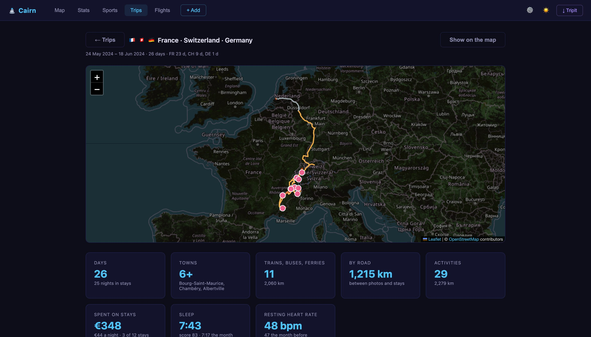 | 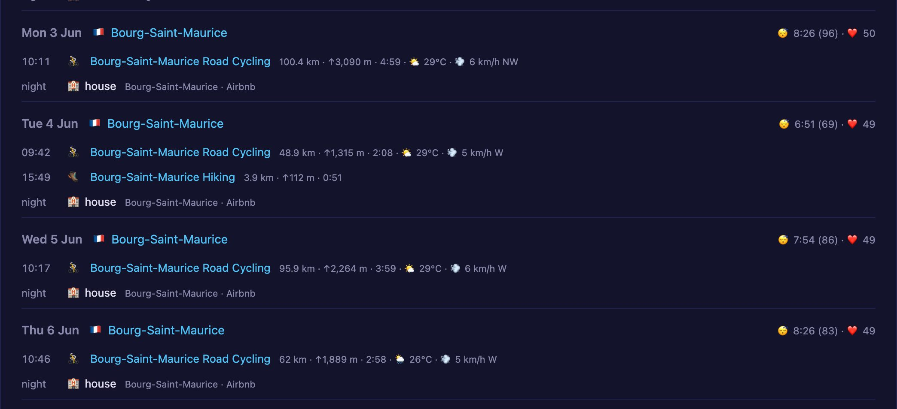 |
| 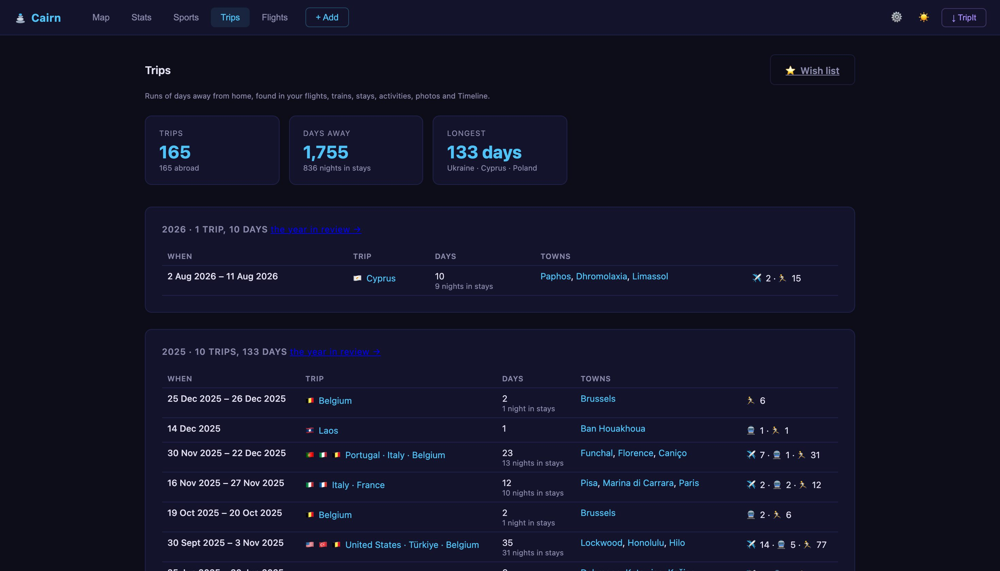 | 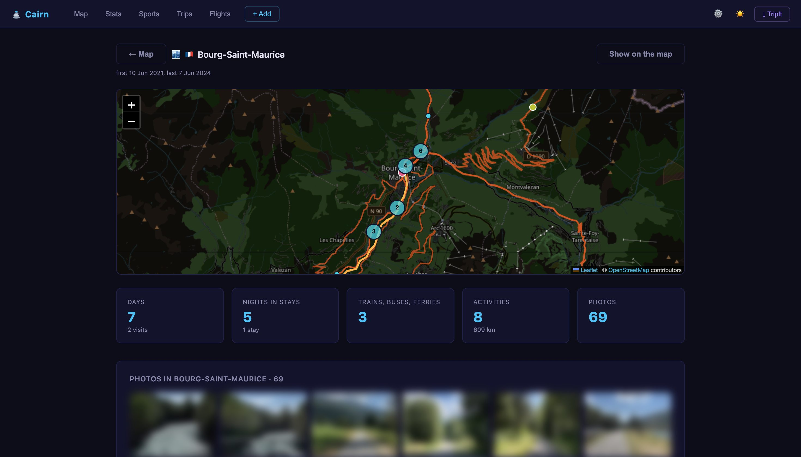 |
| 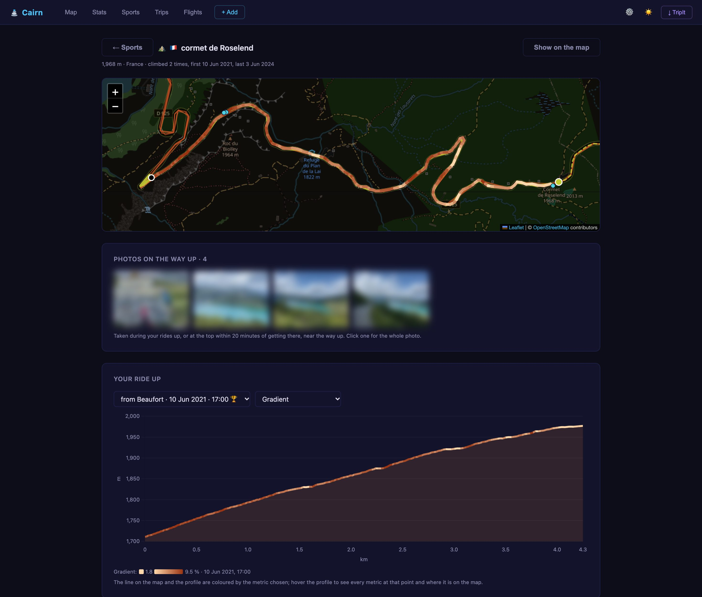 | 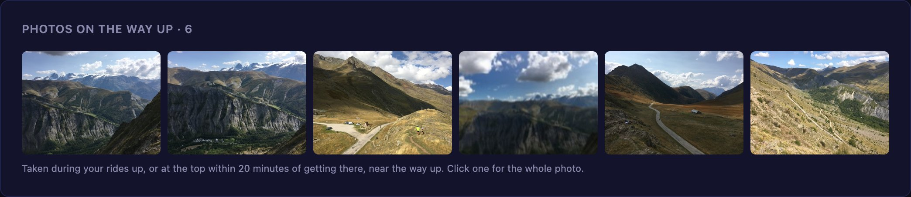 |
| 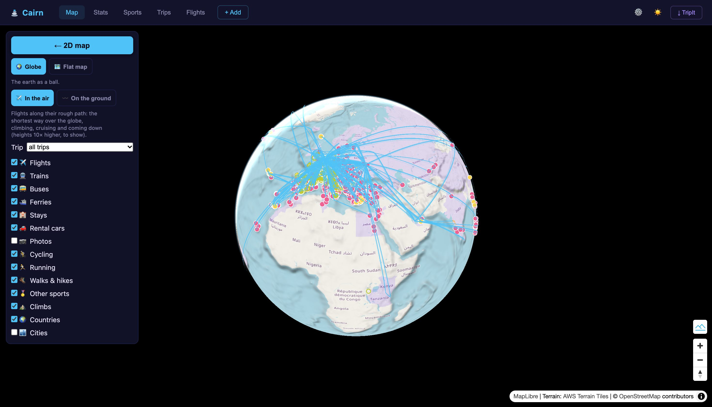 | 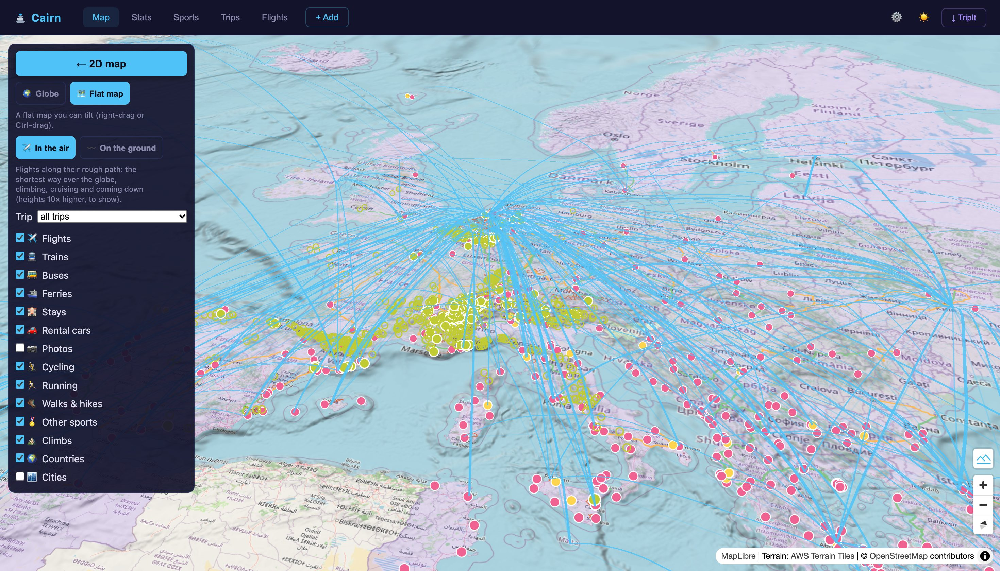 |
| 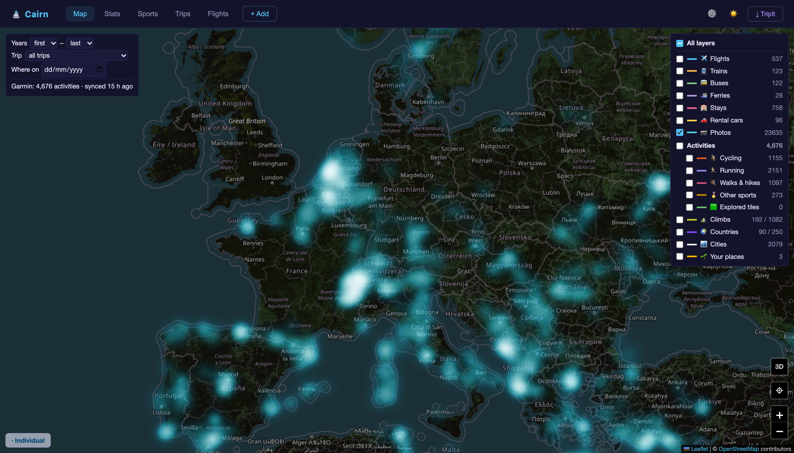 | 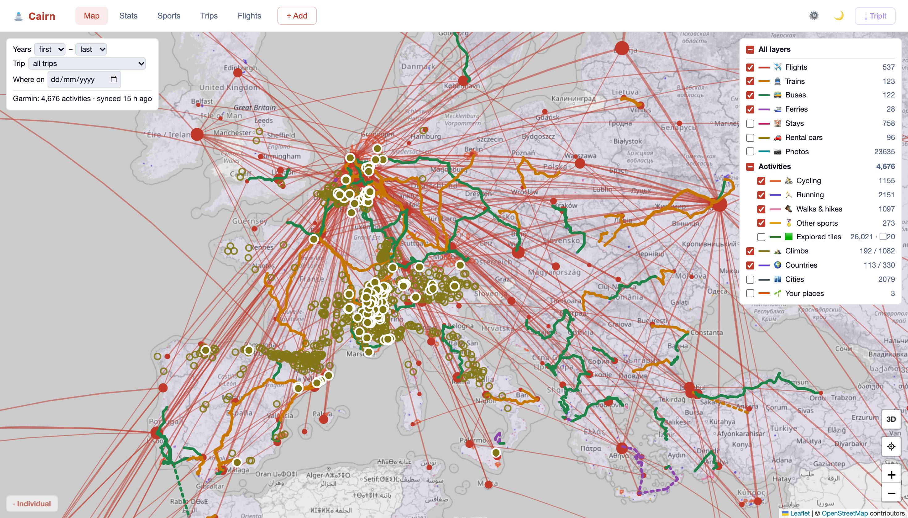 |

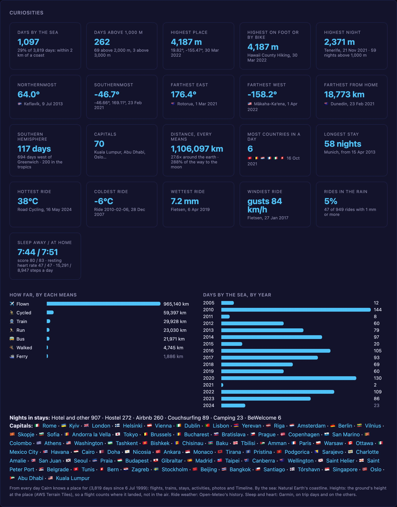

## Contents

- [Features](#features)
- [Repository layout](#repository-layout)
- [Setup](#setup)
- [Running Cairn](#running-cairn)
- [Running on an always-on Mac](#running-on-an-always-on-mac)
- [flightmail](#flightmail)
- [Using Cairn](#using-cairn)
- [Data](#data)
- [API](#api)
- [Tests](#tests)
- [Privacy](#privacy)
- [Troubleshooting](#troubleshooting)

## Features

Cairn:
- **One map of everything**: flights along great circles, trains, buses and ferries along their real tracks (a timetable's, or the likeliest railway line or road), stays and rental cars, photos (clusters or a heatmap, each opening the photo itself), Google Maps Timeline, sports activities and the map tiles they explored, famous cycling climbs, the towns you have been to, and the countries, counted by ISO, as sovereign states or as the Travelers' Century Club does (see [The map](#the-map))
- **3D**: the same layers on a globe with real terrain, or on a flat tilted map with flights as arcs through the air
- **Trips**, found in all your data (not only flights): a **Trips** tab, and a page per trip with its map (the moves between photos, stays and activities, along the roads, as drives with a rental car), its numbers, and **day by day** what happened, in order: flights, trains, rides with their weather, drives, the photos you took, where you slept, how you slept, and the track you played most
- **Towns**: a page per town, with its map, every visit and what you did on it, the stays, flights, trains, activities, photos and the music you played there
- **Climbs**: 1,082 famous cycling climbs, which you rode and which way up; a page per climb with its map, your rides up coloured by speed, gradient, power or heart rate on a profile, your times against what your FTP of that day predicts, a top climber and the record, the weather, and the photos you took on the way up
- **Sports activities** from Garmin (its data export, then a nightly sync) or Strava: a **Sports** tab with Eddington numbers, the year race, every day of a year, records, best efforts and explored tiles (as statshunters counts them); quick with thousands of activities
- **Your body and your music on the way**: sleep, resting heart rate and steps per day from Garmin; the weather on every ride (Open-Meteo's history); your Last.fm scrobbles per trip and per town
- **Statistics and curiosities**: per country (days, visits, nights, flights, trains, activities, photos); days by the sea and above 1,000, 2,000 and 3,000 m, the highest night, the farthest you went north, south, east and west, hemispheres and the tropics, capitals, how far by each means (so many times around the earth), the beds you slept in, every New Year's Eve, the hottest, coldest, wettest and windiest rides, and how you sleep away and at home
- A **period** of years or a trip for everything, and **where you were** on any day
- **Add by hand** what nothing else knows (the trains of your childhood, a stay with friends), with the date as well as you remember it, or **from your photos**: where they jump between towns with nothing connecting them, the leg is suggested to add with a click
- **Flights** still have it all: a searchable list, adding one by flight number and date (airports, airline, aircraft and duration looked up via AeroDataBox), imports from openflights.org (CSV) and TripIt
- **Settings**: kilometres or miles, light, dark, grey, colour, topographic or satellite maps, bold or fine lines, remembered between visits
- **Light and dark mode** (dark by default)

flightmail:
- Reads new Gmail messages every hour, **read only**
- Finds the flights in booking emails from airlines and agencies, in English and Dutch (KLM, Ryanair, easyJet, eDreams, Gotogate, Booking.com, Air France-KLM and similar layouts)
- Creates one **calendar event per flight**, for example `✈️ KL1234: Amsterdam - Lisbon`. Events start and end at the right moment in each airport's time zone, with the booking code (PNR) in the notes.
- Adds the same flight to **Cairn**
- Also adds **trains, buses and ferries** to the calendar, for example `🚆 EC9236: Breda - Bruxelles Midi` or `🚌 Lisboa (Oriente) - Porto (Campanhã)`, and to Cairn's map
- Follows **schedule changes, rebookings and cancellations**
- Reads **hotel, Airbnb and rental car** bookings (Booking.com, Airbnb, DiscoverCars, VIPCars, Rentalcars.com, Holiday Autos, Hertz and other brokers) for the trip docs and Cairn's map
- Keeps **one Google Doc per trip** in a Drive folder: the Plan table gets each stay and rental car, the Transport table each flight, train, bus and ferry, without changing what you wrote (see [Trip docs](#trip-docs))
- **Suggests things to do and an itinerary** in the doc of each coming trip, by Claude, written again whenever the doc changes
- For every flight: a **check-in to-do in Things**, scheduled the day before, with the airline's check-in link; a **busy block in your work calendar** from 2 hours before departure to 1 hour after landing; and an all-day **trip banner** ("Tenerife", "Portugal") over each trip
- **Never duplicates** a flight that is already in the calendar or in Cairn, and never touches events it did not create
- Posts what it **could not read** to Discord, so a missed booking is not silent

## Repository layout

| Path | What it is |
|---|---|
| `app.js` | Cairn server (Express): REST API, AeroDataBox lookup, imports |
| `ground.js` | places and tracks of trains, buses and ferries (Photon, Transitous, OSRM) |
| `activities.js` | all sports activities from every source (Garmin, Strava), each once |
| `strava.js` | Strava sign-in, the activity list and each activity's explored tiles (Strava's API needs a paid subscription) |
| `cities.js` | most visited cities: places and days put in their towns (GeoNames) |
| `regions.js`, `country-lists.json` | countries as a list counts them: ISO codes, sovereign countries or the Travelers' Century Club's 330 (Natural Earth states and provinces) |
| `public/index.html` | Cairn web page (map, stats, list) |
| `public/sports.js` | the Sports tab: cards, charts and tables of your Strava activities |
| `public/city.js` | a town's report page, opened from a city on the map, with its map |
| `trips.js`, `public/trips.js` | trips found in all the data, their moves along the roads (OSRM), the Trips tab and a page per trip |
| `photos.js` | every photo's place and time (`data/photo_points.json`), its thumbnail and the whole photo |
| `suggestions.js`, `public/add.js` | the Add tab beyond flights: trains, buses, ferries and stays by hand, and the legs your photos suggest |
| `stats.js`, `public/curiosities.js` | the curiosities: days by the sea and up in the mountains, extremes, capitals, distances, beds, ride weather, sleep |
| `weather.js` | the weather on your rides (Open-Meteo's history) |
| `lastfm.js` | your Last.fm scrobbles, for the music on trips and towns |
| `public/climb.js`, `climb_records.json` | a climb's page: its map, your times with a profile, predictions, and the best known times (with sources) |
| `public/terrain.js` | the 3D view: globe or flat map with terrain (MapLibre GL), the 2D map's layers, flights as arcs (deck.gl) |
| `climbs.js`, `ascents.js`, `climbs.json` | famous cycling climbs, their ways up (roads and terrain heights) and which your rides went up |
| `public/layers.js` | the map's stays, rental cars, photos, Timeline, Strava activities and tiles, countries, trips, period and "where on" |
| `imports/photos.py`, `imports/timeline.py` | photo places and Google Timeline into Cairn (see [The map](#the-map)) |
| `imports/garmin.py`, `imports/install_garmin.sh` | Garmin activities into Cairn: the data export, the sign-in and the nightly sync (see [Sports activities](#sports-activities)) |
| `imports/test_imports.py`, `imports/fixtures/` | tests of the import scripts, and a made-up Garmin activity file |
| `default.config`, `default.secret` | committed templates for `config` and `secret` (see [Setup](#setup)) |
| `test/*.test.js` | tests of the Cairn API, `ground.js`, `strava.js`, `cities.js` and the Sports tab's numbers |
| `mail/flightmail.py` | flightmail entry point: Gmail, calendar, Cairn and Discord |
| `mail/parse.py` | reads flight legs out of an email (no network) |
| `mail/ground.py` | trains, buses and ferries: operator rules and station time zones (no network) |
| `mail/sync.py` | decides what an email changes; AeroDataBox enrichment (no network) |
| `mail/plan.py` | check-in to-dos, busy blocks and trip banners from the flights you are on (no network) |
| `mail/stays.py` | hotel, Airbnb and rental car bookings out of an email (no network) |
| `mail/tripdocs.py` | trip docs in Google Drive: Google client, the docs' tables, what goes where, the suggestions by Claude; `auth` signs in once |
| `mail/test_*.py`, `mail/fixtures/` | flightmail tests and anonymised test emails |
| `mail/install.sh`, `mail/cairn.plist.template` | install flightmail and the Cairn service on a Mac (launchd) |
| `docs/superpowers/` | design and implementation plan of flightmail |

## Setup

Requirements: Node.js 18+ for Cairn; for flightmail also Python 3.10+ on macOS with `pyobjc-framework-EventKit`.

### 1. Install dependencies

In the `contrail` folder:

```
npm install
```

This installs Express, the only dependency.

### 2. Configure

Settings live in `config` and keys in `secret`. Both are JSON files, both are gitignored, and the server does not start without them. Copy the templates:

```
cp default.config config
cp default.secret secret
```

`config`:

| Key | Default | Meaning |
|---|---|---|
| `host` | `127.0.0.1` | address the server listens on: `127.0.0.1` is this machine only, `0.0.0.0` opens it to the network |
| `port` | `3000` | port the server listens on |
| `data_dir` | `data` | folder for runtime data (gitignored) |
| `flights_file` | `data/flights.json` | the flight list |
| `airports_file` | `data/airports.dat` | OpenFlights airport database, downloaded on first run |
| `csv_backup` | `""` | openflights.org CSV export to import on first run (see [Importing](#importing-from-openflightsorg)) |
| `ground_file`, `stays_file`, `photos_file`, `timeline_file`, `strava_file`, `strava_token_file` | `data/…` | where the map's other data is kept (see [Data](#data)) |
| `ground_lookups` | `true` | look up places and tracks of trains, buses, ferries and stays (see [Ground trips](#ground-trips)) |
| `flightmail` | | flightmail settings (see [flightmail settings](#settings)) |

`secret`:

| Key | Meaning |
|---|---|
| `rapidapi_key` | RapidAPI key for AeroDataBox flight lookup (optional, see below) |
| `tripit_client_key`, `tripit_client_secret` | TripIt OAuth app (optional) |
| `strava_client_id`, `strava_client_secret` | Strava API app, for your activities on the map (optional, see [The map](#the-map)) |
| `lastfm_api_key`, `lastfm_user` | a Last.fm API key and your user name, for the music on trips and towns (optional, see [Music](#music)) |
| `flightmail` | flightmail's Gmail app password and Discord webhook (see [flightmail settings](#settings)) |

### 3. AeroDataBox key (optional, recommended)

Flight lookup by number and date uses the [AeroDataBox API](https://rapidapi.com/aedbx-aedbx/api/aerodatabox) via RapidAPI. The free tier allows about 500 lookups per month, which is plenty for personal use.

1. Sign up at [rapidapi.com](https://rapidapi.com)
2. Subscribe to the AeroDataBox API (free tier)
3. Copy your `X-RapidAPI-Key` into `secret` as `rapidapi_key`

Without a key you can still add flights by hand, and flightmail falls back to what the email says.

## Running Cairn

```
node app.js
```

Then open [http://localhost:3000](http://localhost:3000).

On first run the app creates `data/`, downloads `airports.dat` from the [OpenFlights dataset](https://github.com/jpatokal/openflights) (about 6 MB, about 7,700 airports) and, if `csv_backup` is set, imports that CSV into `data/flights.json`. Later starts load `data/flights.json` directly.

## Running on an always-on Mac

Cairn and flightmail can run permanently on another Mac, here a Mac mini reached as `ssh mini`. Cairn listens only on that machine (`"host": "127.0.0.1"`), so nobody else on the network can see or change your flights and no login is needed. That Mac's `data/flights.json` becomes the only copy in use.

1. Make an environment with Node, Python and EventKit, for example with micromamba:
   ```
   micromamba create -n contrail -c conda-forge python=3.12 nodejs=22 pip
   ~/micromamba/envs/contrail/bin/pip install pyobjc-framework-EventKit
   ```
2. Clone the repo, run `npm ci`, and copy `config`, `secret` and `data/` from the machine you used before (`chmod 600 config secret`).
3. Run `mail/install.sh`. It installs the Cairn server as the launchd service `nl.tue.cairn`, which restarts on crash and at login (log: `~/.flightmail/cairn.log`), and it installs flightmail (see [Install](#install)). `PYTHON` and `NODE` override the interpreters it uses.

Open Cairn from your laptop through an ssh tunnel. Use the same port on both ends so the TripIt sign-in callback keeps working:

```
ssh -N -L 3000:localhost:3000 mini
```

then browse to [http://localhost:3000](http://localhost:3000). Stop the tunnel with Ctrl-C.

## flightmail

### What it does

Every hour flightmail reads the Gmail messages that arrived since its last run. For each email:

| Email | What happens |
|---|---|
| **New booking** | One calendar event per flight leg and the same flight in Cairn. Only flights where you are a passenger (`passenger_names`); an email that lists no passengers counts as yours. Only flights that are still ahead. |
| **Schedule change** | The event and the Cairn flight get the new times; the event gets a dated note such as `Updated 2026-10-21: schedule change (Gotogate)`. |
| **Rebooking** | The old flight is deleted from both places and the new one created with a `Rebooked from KL1234 on 2026-11-16` note. |
| **Cancellation** | The event and the Cairn flight are deleted. |
| **Train, bus or ferry ticket** | One calendar event per journey and the same trip in Cairn, for the map. Cancellations delete both, also when the email gives only the booking number. |
| **Hotel, Airbnb or rental car** | Booking.com, Airbnb, DiscoverCars and VIPCars confirmations, and those of other car rental brokers and companies (Rentalcars.com, Holiday Autos, Argus Car Hire, Stressfree Car Rental, BSP Auto, EconomyBookings, QEEQ, Hertz, Thrifty, Goldcar), go into the trip docs (below) and to Cairn's map, not the calendar. Their cancellations undo that. |
| **Anything else** | Ignored: check-in reminders, boarding passes, price alerts, surveys, newsletters, "choose an option" emails, replies and forwards. |

Each event:
- **Title:** `✈️ <flight>: <departure city> - <arrival city>` for flights; `🚆` trains, `🚌` buses and `⛴️` ferries use the station names and, for trains, the train number: `🚆 EC9236: Breda - Bruxelles Midi`
- **Times:** start and end at the real departure and arrival moments; the event's time zone is the departure airport's
- **Location:** the departure airport or station
- **Notes:** `Confirmation Code: <PNR>`, the agency's number if any, and a `flightmail` marker line
- **Alert:** one reminder 15 minutes before
- When an email gives no arrival time (SNCF Connect), the event lasts one hour and its notes say the end time is a guess.

A Cairn flight gets the date, route, flight number, airline and duration; the server computes the distance.

**Around each flight.** flightmail keeps a list of every future flight you are on (and of trains, buses and ferries, for busy blocks), also the ones whose events you made yourself, and on every run keeps three things in step with it. When a flight moves or is cancelled, they follow; things in the past are left alone.
- **Check-in to-do** in a Things project (`things_project`, default "✈️ Travel"), one per booking, for its first flight: `check in KL1234`, scheduled the day before departure (today if that has passed) with its deadline on that same day, with the check-in link (from the booking markup, else the airline's check-in page, else a web search) and the booking code in its notes. A cancelled flight cancels its to-do.
- **Busy block** in your work calendar (`work_calendar_account` / `work_calendar_title`) for each flight, train, bus or ferry that falls in working hours: `🛑 Vibe-busy`, from 2 hours before departure to 1 hour after arrival, made only when that time overlaps Monday to Friday 09:00–17:00 in `home_timezone`. Shown as busy, no alerts, with `[auto-split]` in its notes so [calsplit](https://github.com/bazilinskyy/vibe-work)'s nightly cleanup deletes it once past.
- **Trip banner**: an all-day event in the travel calendar from the day you leave a home airport (`home_airports`) to the day you are back, named after the place you stay ("Tenerife"), the country when you stay in several places ("Portugal"), or the countries ("Spain · France"). It is shown as free, with alerts at 15:00 the day before and 09:00 on the day. When an all-day event of yours already covers the trip, no banner is made. A trip without a known return gets no banner yet.

#### Trip docs

When `trip_docs_folder` is set and flightmail is signed in to Google (see [Install](#install)), it keeps one Google Doc per trip in that Drive folder, the docs you already keep there included. It reads and edits them through the Google Drive and Docs APIs on every run, with your own Google sign-in. Each doc has an Information heading, a Plan table (Place | Dates | Accommodation | Price | Comments) and a Transport table (Transport | Date | Price | Comments).
- **Which doc:** the doc whose Plan or Transport dates overlap the booking or trip (a day of slack). With none, flightmail creates one with that layout, named after the trip and year: "Faro 2027", the country when it has several places ("Portugal 2026"), with " 2" added if the name is taken.
- **Hotel or Airbnb:** the Plan row with that place and overlapping dates gets the Accommodation (the type, "Hotel", "Hostel", "Flat", "Room" or "House", linked to the booking) and the Price, but only cells that are empty. With no such row, a new row goes in date order with the place, the dates written `22–23.10.26`, the accommodation and the price.
- **Cancelled hotel or Airbnb:** its Accommodation and Price cells are emptied; place and dates stay.
- **Rental car:** `Rental car 26–30.09`, linked to the booking, is added to the Comments (or a Car column) of the row whose stay holds the pick-up day, else to a Transport row.
- **Flights, trains, buses and ferries:** one Transport row each, titled like the calendar event (`✈️ KL1234: Amsterdam - Lisbon`, `🚌 Faro - Albufeira`), with the departure (`07.12.26 16:10`) and the booking code in Comments, in time order: an empty row in that place is filled, else a row is inserted. A cancelled or rebooked trip empties its row. A train, bus or ferry only joins a doc that covers its day; it never creates one, and waits until a flight or stay brings one.
- **Your text is never changed**: flightmail only writes into empty cells, adds rows, and empties the cells it wrote. Bookings that are over are left alone.
- **Remembered:** `state.json` keeps which booking went into which doc, so a booking is written once, and a cancellation or change finds its row again.

**Suggestions.** When the doc of a trip that is not over yet changes, by your edits or by flightmail's, flightmail asks Claude for things to do and an itinerary and writes them into a **Suggestions** section of the doc:
- **When:** on each hourly run, for each doc in the folder whose Drive "modified" time moved since the last run, whose Plan or Transport dates reach today or later, and that was last changed more than 30 minutes ago (you may still be typing; flightmail's own edits of that run wait for the next one too). The doc's text without the Suggestions section is compared with the last time; when only the suggestions or the formatting changed, Claude is not asked again. At most three docs per run; the others follow an hour later. A coming trip's doc that has no Suggestions section yet gets one on the first run.
- **What Claude gets:** the doc as text (Information notes, the Plan and Transport tables; links reduced to their text and booking codes left out), today's date, and the request: 3 to 6 specific things to do in or near each place of the Plan (where the flights go when the Plan is empty), following your notes and comments, and one line or two per day from today (or the first day) to the last, following the stays' dates and transport times.
- **What goes in the doc:** a Suggestions heading, an italic line with the date, a **Things to do** heading with a bulleted list per place, and an **Itinerary** heading with a bullet per day (`Thu 12.11, Faro: ...`). The section runs from its heading to the next top-level heading, or to the end of the doc, and is flightmail's own: it is replaced as a whole each time, so move what you want to keep above it. Delete the section and it comes back on the next change of the doc.
- **How:** with the [Claude Code](https://claude.com/claude-code) command line (`claude -p`, model `suggestions_model`, default Sonnet, no tools), signed in on the Mac, so it uses that account's plan; about a minute per doc. When Claude fails (not signed in, a usage limit), the run logs it and tries again an hour later. `"trip_suggestions": false` turns it off.

**Never twice.** A train, bus or ferry is already in the calendar when any event starts within five minutes of it, whatever its title. A flight that is already in the calendar is not added again. That means an event on the same day whose title holds the same flight number with any airline prefix: `EJU7883`, `U27883` and `U2 7883` are the same flight. In Cairn, a flight on the same day with the same route or the same flight number counts as already there. flightmail never changes or deletes events or flights it did not create.

**Alerts** go to a Discord webhook:
- emails about a trip still ahead that look like a flight booking but could not be read
- changes or cancellations for flights flightmail did not create
- run failures

An alert gives the sender, subject and date, never the email body.

The mailbox is only read (IMAP `EXAMINE`, `BODY.PEEK`): nothing is marked, moved or deleted.

### How it works

1. **Gmail** (`fetch_new`): IMAP with an app password. It reads the All Mail folder, without sent mail, through a broad Gmail search for flight words in several languages. The first run looks back `lookback_days`; later runs read messages newer than the last one seen.
2. **Reading the email** (`parse.py`), in this order:
   - the schema.org `FlightReservation` markup (JSON-LD or microdata) that many airlines embed;
   - labelled blocks (`From:` / `To:` / `Flight number:` / `Departure:` / `Arrival:`, with the old and new sections of a rebooking);
   - otherwise, flight numbers with the airports, dates and times around them.

   A flight number counts only when its airline exists in OpenFlights' `airlines.dat` and an airport or a flight word is nearby, so codes like `V33IPW` or an IBAN are not mistaken for flights. Dates and times are read in English and Dutch. Booking codes come from labels such as PNR, booking reference, boekingscode or reserveringsnummer, and agency numbers from eDreams, Booking.com and Gotogate. The email is classed as booking, change, cancellation or other.
3. **AeroDataBox** (`sync.enrich`): for every future leg, flightmail asks Cairn's `/api/flights/lookup` for the airports and scheduled local times of that flight number on that day, and these win over the email. This fixes layouts that give only city names or put details in odd places. Each flight and day is looked up once (cache `~/.flightmail/lookups.json`), at most `lookup_monthly_limit` times per month. Flights AeroDataBox does not know keep the email's data.
4. **Deciding** (`sync.apply`): the rules above, against a state file that remembers which events and Cairn flights flightmail created.
5. **Trains, buses and ferries** (`ground.py`): recognised by the sender (NS International, SNCF Connect, Deutsche Bahn, Eurostar, Trainline, FlixBus, redBus, Rede Expressos, 12Go, ferry operators and more) or by schema.org `BusReservation` / `TrainReservation` / `BoatReservation` markup, which is read first. NS International, SNCF Connect, redBus and Rede Expressos have their own text rules. A station's time zone comes from the [GeoNames](https://www.geonames.org/) list of towns over 1,000 people (`data/cities1000.txt`, downloaded once, CC BY 4.0): the biggest town whose name starts the station name ("Bruxelles Midi" → Brussels), else `home_timezone`.
6. **Writing:** calendar events go through macOS Calendar (EventKit), so any calendar macOS sees works, for example a Google calendar added in System Settings. Cairn flights go through its REST API.
7. **Trip docs** (`tripdocs.py`): the Drive API lists the docs in the folder; the Docs API reads each one's tables (found by their header rows, `Place` and `Transport`) and writes cells and rows with `batchUpdate`. What should be in the docs (every stay, rental car, flight, train, bus and ferry not over yet) is compared with what was written last time (`state.json`), and only the difference is written. Then the suggestions: Drive's Markdown export of each changed doc of a coming trip goes to `claude -p`, whose JSON answer is written as the Suggestions section.

Time zones come from the airport database: every local time is placed in its airport's zone, including across daylight-saving changes and for flights that land after midnight.

### Settings

In the `"flightmail"` sections of `config` and `secret`:

| Key | File | Meaning |
|---|---|---|
| `gmail_user` | config | the Gmail address to read |
| `passenger_names` | config | your name(s) as on tickets, e.g. `["Jan Testers"]` |
| `calendar_account`, `calendar_title` | config | the calendar to write to, as macOS Calendar names them (default `Google` / `Travel`); `mail/flightmail.py calendars` lists them |
| `lookback_days` | config | how far the first run looks back (default 365) |
| `cairn_url` (the older `contrail_url` works too) | config | Cairn's address (default `http://127.0.0.1:3000`) |
| `lookup_monthly_limit` | config | maximum AeroDataBox lookups per month (default 100) |
| `home_timezone` | config | time zone for stations that match no known town (default `Europe/Amsterdam`) |
| `things_project` | config | Things project for check-in to-dos (default `✈️ Travel`) |
| `work_calendar_account`, `work_calendar_title` | config | calendar for busy blocks (default `TUe` / `Calendar`) |
| `home_airports` | config | airports a trip starts from and returns to (default `AMS`, `EIN`, `RTM`) |
| `trip_docs_skip` | config | booking codes that never go into a trip doc (for example a work trip) |
| `trip_docs_folder` | config | id of the Google Drive folder for trip docs (the part after `folders/` in its link); empty: no trip docs |
| `trip_suggestions` | config | things to do and an itinerary by Claude in the docs of coming trips (default `true`) |
| `suggestions_model` | config | the Claude model for them, as `claude --model` takes it (default `sonnet`) |
| `claude_path` | config | the `claude` command (default: found in `PATH`, else `~/.local/bin/claude`) |
| `gmail_query` | config | optional Gmail search that preselects mail; empty uses the built-in one |
| `gmail_app_password` | secret | a Gmail [app password](https://myaccount.google.com/apppasswords) (needs 2-Step Verification) |
| `discord_webhook` | secret | Discord webhook for alerts; empty sends nothing |

### Install

On the always-on Mac, from the checkout:

```
mail/install.sh
```

macOS gives calendar access per app and silently refuses it to a bare Python started by launchd. So the script builds a small AppleScript app, `~/.flightmail/flightmail.app`, which holds the Calendar permission and runs `flightmail.py`. It builds the app only once, because a rebuild changes its signature and macOS would ask again. The script then schedules the app every 60 minutes (launchd `nl.tue.flightmail`) and installs the Cairn service if it is missing.

Then fill in the `flightmail` settings and, **with the screen unlocked**, run a dry run and click Allow on the Calendar prompt (and, on the first real run that makes a to-do, on the prompt to control Things):

```
open -W --env FLIGHTMAIL_ARGS=--dry-run ~/.flightmail/flightmail.app; tail -40 ~/.flightmail/run.log
```

A dry run reads the mail and logs what it would create, update or delete, without changing anything. Only lookups happen, and they are cached. Read the list, then run once for real:

```
open -W ~/.flightmail/flightmail.app; tail -40 ~/.flightmail/run.log
```

The first run reads a year of matching mail and takes about ten minutes; later runs take seconds.

**Trip docs (optional).** flightmail edits Google Docs with its own Google sign-in, made once:
1. In the [Google Cloud console](https://console.cloud.google.com/), create a project (any name), then enable the **Google Drive API** and the **Google Docs API** (APIs & Services → Library).
2. APIs & Services → OAuth consent screen: user type **External**, fill in the app name and your email, add yourself as a test user, then **Publish app** (status "In production"). In testing status Google expires the sign-in after 7 days. The app stays unverified; that only means a warning when you sign in.
3. APIs & Services → Credentials → Create credentials → **OAuth client ID**, type **Desktop app**. Download the JSON and copy it to the Mac as `~/.flightmail/google_client.json`.
4. Sign in once. On the Mac itself: `python mail/tripdocs.py auth` and open the printed link. From another computer, keep a tunnel open so Google's redirect reaches the Mac: `ssh -L 8765:localhost:8765 <mac>`, run the command there, and open the link on your own computer. After you allow access (click past the "unverified app" warning), the refresh token is saved to `~/.flightmail/google_token.json` (mode 600).
5. Set `trip_docs_folder` in `config`, then do a dry run: it lists every cell it would write and every doc it would create.

The sign-in asks for full Drive access, because the trip docs you made yourself must be editable too.

**Suggestions (optional).** Install [Claude Code](https://claude.com/claude-code) on the Mac and sign in once (`claude`, then `/login`). flightmail runs it from the app started by launchd, which can read the login in the keychain (cron could not). Check with `echo 'Say hi' | ~/.local/bin/claude -p --model sonnet --tools ""`.

### Files

| File | What it is |
|---|---|
| `~/.flightmail/run.log` | log: each email acted on, each change, alerts and failures |
| `~/.flightmail/state.json` | last message read, the events and Cairn flights flightmail created, the stays, which booking went into which trip doc, and each doc's last suggestions (Drive modified time and a hash of its text) |
| `~/.flightmail/lookups.json` | AeroDataBox answers and this month's lookup count |
| `~/.flightmail/flightmail.app` | the app that holds the Calendar permission |
| `~/.flightmail/google_client.json`, `google_token.json` | the Google OAuth client and refresh token for the trip docs; never in the repo |

Other commands: `mail/flightmail.py calendars` lists the calendars EventKit sees. `mail/flightmail.py history [--days N] [--dry-run]` sends the stays, rental cars, trains, buses and ferries of past years (default 6000 days) from the mail into Cairn's map, never into the calendar or the trip docs; the hourly run only handles trips still ahead. A booking whose place, code or date could not be read is listed in its output and left out. It is safe to run again. `--rescan-days N` reads all matching mail of the last N days again, for example after new rules were added (`open -W --env FLIGHTMAIL_ARGS="--rescan-days 365" ~/.flightmail/flightmail.app`); nothing is added twice.

To remove the hourly job:

```
launchctl bootout gui/$(id -u)/nl.tue.flightmail; rm ~/Library/LaunchAgents/nl.tue.flightmail.plist
```

### Limits

- **Languages:** English and Dutch text rules. Other languages (for example French Transavia emails) are read only through schema.org markup or AeroDataBox.
- **Attachments:** PDF e-tickets and attachments are not read.
- **Not read:** trains, buses and ferries from operators without a rule or markup; add a rule in `ground.py` with a fixture and a test. Hotels and cars from other senders than those listed above; add a rule in `stays.py`.
- **Trip docs:** a cancelled rental car is only logged; remove it from the doc by hand. A changed booking is treated as cancelled and booked again.
- **Suggestions:** Claude answers from what it knows, without searching the web, so opening hours, prices and seasonal closures should be checked. An edit made while flightmail writes the suggestions waits for the doc's next change.
- **New layouts:** a layout none of the rules handle shows up as a "could not read" alert. To support it, add an anonymised copy to `mail/fixtures/`, a test in `mail/test_parse.py`, then a rule in `parse.py`.

## Using Cairn

### The map

The legend at the top right shows or hides each layer, with how many it holds in the period shown:
- **Flights** (with their airports), **trains**, **buses** and **ferries**.
- **Stays** (pink, bigger for more nights) and **rental cars** (yellow, at the pick-up place). flightmail sends every Booking.com, Airbnb, DiscoverCars and VIPCars booking it reads to Cairn, which finds the place with Photon and keeps it.
- **Photos**: where your photos were taken, about 1 km per dot, bigger for more photos. From `imports/photos.py` (below).
- **Timeline**: the places and daily paths of Google Maps Timeline. From `imports/timeline.py` (below).
- **Activities**: your sports activities (see [Sports activities](#sports-activities)), a group in the legend with a row per type, **Cycling**, **Running**, **Walks & hikes** and **Other sports** (orange, violet, magenta, yellow), and **Explored tiles**; the group's box turns them all on or off, a type's box shows it alone. Activities without a route (indoor, virtual, swims without GPS) are counted but not drawn.
- **Explored tiles**: the map squares your activities passed through, as [statshunters](https://www.statshunters.com) and VeloViewer count them: tiles at zoom 14 (about 1.5 km in the Netherlands), or squadratinhos at zoom 17 (about 200 m), as chosen in the settings. Zoomed in far enough, the grid of all tiles shows (can be turned off), so the unexplored ones you could ride or run to stand out. Darker: your **max cluster**, the biggest group of tiles whose four neighbours are explored too. Dashed: your **max square**, the biggest square of explored tiles; click it for the numbers. The legend shows the tile count and the square's size, for the period and the activity types shown.
- **Countries** you have been to, shaded, with your days there, first and last visit; the legend shows how many of the list's countries you have. A country counts when you were there on a day by any source: you landed or took off there (not only to change planes), took a train, bus or ferry there, stayed, rented a car, took a photo, started an activity or Timeline saw you there. Choose in the settings how countries are counted:
  - **ISO countries and territories** (250): every ISO 3166 country code, and Kosovo. Greenland, Puerto Rico, Hong Kong, Réunion and Svalbard count apart.
  - **Sovereign countries** (200): the 193 UN members, the Vatican and Palestine, Cook Islands, Niue, Kosovo, Taiwan and Northern Cyprus, as the Travelers' Century Club takes them. A territory (Greenland, Réunion) counts for none.
  - **[Travelers' Century Club](https://travelerscenturyclub.org/countries-and-territories)** (330): islands, parts of countries and claims count apart: the Canary Islands, Sicily, Scotland, Alaska, Russia in Asia, Turkey in Europe, Zanzibar, the Antarctic claims.

  Each place is put in its state or province from [Natural Earth](https://www.naturalearthdata.com)'s 1:10m map (`data/admin1.geojson`, 40 MB, downloaded on first use), and that in a country of the list (`country-lists.json`: whole countries, provinces, and boxes for islands Natural Earth does not draw apart). A point just off the coast goes to the province within about 20 km. Choices made for the Travelers' Century Club list: Russia is split at the federal districts (Urals and east are Asia); Crimea counts as Ukraine; the Amami islands stay Japan, not Ryukyu; Kashmir is the Indian-administered part; where the Antarctic claims overlap, the Argentine one counts.
- **Cities**: every town you have been to, sized by the days you were there, the ten most visited labelled; click one for its days, separate visits (a gap of more than a day starts a new one), and first and last day. A day counts in a town when, that day, you landed there or left from its airport (not when only changing planes), took a train, bus or ferry from or to it, slept there, picked up a rental car, took photos, started a Strava activity or Timeline saw you there. Each place goes to the town that pulls hardest, its population over the distance squared, within 25 km (GeoNames' towns over 1,000 people, `data/cities1000.txt`, which flightmail downloads); an airport goes to the city it is named for (Boryspil airport counts for Kyiv). The **Stats** tab lists the top ten of all time.
- **Climbs** (with any rides): 1,082 famous cycling climbs, the climbs in the cycle-racing categories of six Wikipedias (English, French, Italian, Dutch, German, Catalan; towns and buildings left out), with their summits from Wikidata (`climbs.json`). Filled when one of your rides passed within 150 m of the top. A climb's **ways up** (Mont Ventoux from Bédoin and from Malaucène) are worked out in the background the first time a ride comes within 1.5 km of it: roads from the top down to the towns around (OSRM), heights along them from the open AWS Terrain Tiles; a way up starts where the road begins to climb (the next 2 km rise 3.5% or more) and ends at the road's high point. A ride counts for a way up when it rode that way's last 2 km up to the top, going up, and also the part that sets it apart from the climb's other ways (Bédoin and Sault share the last 6 km). A ride up a way not found is named after the nearest town 12 km before the top ("via Sault"). The popup lists each way up with its length, height gain and gradient, ✓ with your rides up it; the ways up you rode are drawn on the map. Kept in `data/climb_ascents.json`.
- **Climb page**: "Open climb page →" in a climb's popup (or a climb's name in the Sports tab; address `#climb=<Wikidata id>`) shows its map with the ways up and your rides; **your ride up**, any effort, on the map and as a height profile coloured by speed, climbing speed (VAM), gradient, power, W/kg or heart rate; per way up your best time, what your FTP and weight now and on that day predict, a top climber (6 W/kg) and the **best known time** (`climb_records.json`: from race data, Wikipedia and watts2win.eu, each with its source and how it was measured), every ride up with its power, heart rate and the weather; the **photos you took on the way up** (during a ride up, or at the top within 20 minutes); and about the climb, from Wikipedia.
- **3D**: the button above the locate button opens the map in 3D with real terrain (MapLibre GL, AWS Terrain Tiles), tilted when zoomed in, with the layers of the 2D map (switched in its panel too: the same choice) for the period or trip chosen there. Two views: **🌍 Globe**, the earth as a ball, flights along its curve; **🗺️ Flat map**, flights as arcs through the air (deck.gl; it cannot draw them on the globe). Right-drag (or ctrl-drag) to tilt and turn; the mountain button switches the terrain off and on; **← 2D map** (or Esc) goes back to the same place.
- **City report**: "Open report" in a city's popup opens a page for that town (in the period shown): days and separate visits, each visit with what happened in it, then the stays and rental cars (with the hotel), flights in and out, trains, buses and ferries from or to it, the sports activities that started there (click one for its route), photos per month and Google Timeline places, and a small map of the town you can drag and zoom with all of that, the photos and the famous climbs around it. Each visit links to its trip. Its address, `#city=<GeoNames id>`, can be bookmarked.
- **Trips** (the tab): the runs of days you were away, by year. A day is away when anything (a flight, train, stay, activity, photo, Timeline) puts you outside your home countries (those of `home_airports`), or you slept in a stay; days in a row make a trip when it has a night in a stay, a flight, a train, bus or ferry, or lasts three days or more, so a ride over the border and back is none. Days between a flight out and a flight home count as away (up to 90 days). A trip's page (`#trip=<first day>`) has its map: flights, trains, buses and ferries, stays, activities, photos, and the **moves** between them as Polarsteps draws them: from photo to photo, activity to activity and stay to stay, when nothing of your own shows how you got there; moves of 10 km or more follow the likeliest road route (OSRM, looked up in the background, kept in `data/drives.json`), in yellow as a **drive** on days with a rental car. Then its numbers, **day by day** where you were (towns, linked to their pages), how you moved, what you did and where you slept, and its stays, flights, trains, activities and famous climbs.

The box at the top left sets the period:
- **Years**: only what happened from one year to another.
- **Trip**: one trip of the Trips tab (above; until those have loaded, from leaving a home airport, `home_airports` in the `"flightmail"` section of `config`, until landing at one again). The map zooms to it; **page →** opens the trip's page.
- Where the activities come from: Garmin, with its last sync (or why it failed); Strava, when it is set up, with **fetch now** (else **Connect Strava**).
- **Where on**: a day. A marker shows where you were: your stay that night, else the end of that day's last flight or ride, else a Timeline place or photos. With nothing that day, the last place known before it.

**Photos.** On the Mac that has your Photos library, from a checkout of this repository (or just the script), with [uv](https://docs.astral.sh/uv/) so nothing gets installed:

```
uv run --with osxphotos python imports/photos.py --send mini:repos/contrail/data/photos.json
```

It reads the library at `~/Pictures/Photos Library.photoslibrary` (another with `--library`; a folder of files with `--folder`, which needs exiftool) and keeps only the places rounded to about 1 km, the number of photos and the days, per year: no file names, pictures or exact positions. `--send` copies the result to the Mac that runs Cairn; run it again after new photos.

**Google Photos** cannot be read through Google's API for this (since March 2025 it only gives apps the photos they uploaded themselves, and it never gave their places). Export it with [Google Takeout](https://takeout.google.com) instead: only Google Photos, as zip files. Then, with the zips as they came (no need to unpack them, or give the unpacked folder):

```
python imports/photos.py --takeout ~/Downloads/takeout-*.zip --send mini:repos/contrail/data/photos.json
```

Sources can be combined in one run, for example the laptop's library copied to mini and the Google Takeout: `--library ~/Pictures/Laptop.photoslibrary --takeout ~/Takeout/takeout-*.zip`. A photo that is in both (the same moment and place) counts once; each run replaces the file, so give every source each time.

Only the small `.json` file Google puts beside each photo is read (when it was taken and where, from the camera or a place you set in Google Photos), never the photo itself; a photo that is also in an album counts once. A new export replaces the last one, so export everything each time.

**Google Maps Timeline.** Export it on your phone (Android: Settings > Location > Location services > Timeline > Export Timeline data; iPhone: Google Maps > Settings > Personal content > Export Timeline data), or use an older Takeout of Location History, then:

```
python imports/timeline.py ~/Downloads/Timeline.json --send mini:repos/contrail/data/timeline.json
```

Every layout Google has used works: the phone's `Timeline.json` (Android and iOS), Takeout's "Semantic Location History" folder and `Records.json`. It keeps the places you stayed at, with their times and names, and each day's paths, simplified to about 50 m and cut where you flew.

Cairn reads both files again whenever they change; no restart is needed.

The **All layers** box at the top of the legend turns every layer on or off at once.

**Settings** (⚙️ in the top bar, kept in this browser): kilometres and metres or miles and feet, everywhere (flight statistics and list, popups, the Sports tab: speeds in mph, paces per mile, the Eddington number in miles, ride best efforts at 30, 60, 100 and 125+ miles); tiles at zoom 14 or squadratinhos at zoom 17 (worked out in the browser from each route the first time, then kept); whether to show the tile grid; how countries are counted, on the map and in the Stats tab's Countries table; the **map**: following the light or dark theme, light grey or dark grey (lines and markers stand out, as on statshunters), OpenStreetMap in colour, topographic (OpenTopoMap) or satellite (Esri); and **lines and markers**: standard, bold (thicker, solid lines and bigger markers, best on a grey map) or fine. The browser also remembers which layers you show, where the map was, and whether airports are clustered. The button above the zoom buttons (bottom right) centres the map on where you are (the browser asks you to allow it the first time; it works on `localhost`, also through the tunnel, and on https).

### Sports activities

Your rides, runs and other activities come from Garmin, free of charge: your whole history from Garmin's data export, then new ones every night from Garmin Connect. Both are `imports/garmin.py`, run with [uv](https://docs.astral.sh/uv/) so nothing gets installed; it writes `data/garmin.json`, which Cairn reads again whenever it changes.

1. **Your history.** On garmin.com, Account > Data Management > **Export Your Data**; Garmin emails a link to a zip within a few days. On the Mac that runs Cairn, give it the zip as it came (or its unpacked folder):
   ```
   ~/.local/bin/uv run --with fitdecode python imports/garmin.py export ~/Downloads/<the export>.zip
   ```
   Each activity gets its name and type from Garmin's summary and its route, distance, time, climbing and heart rate from its own file (the full track, simplified to about 20 m for the map; its explored tiles from the full track). Activities without a file (manual ones) come from the summary alone. Running it again with a newer export adds and updates; nothing is added twice.
2. **Sign in to Garmin Connect once**, in a terminal (also over SSH): your email, password and, with two-step verification, the code. The password is not kept; a token in `~/.garminconnect` (readable by you only) lasts about a year:
   ```
   ~/.local/bin/uv run --with garminconnect python imports/garmin.py login
   ```
3. **The nightly sync**: `imports/install_garmin.sh` installs the LaunchAgent `nl.tue.cairn-garmin`, which runs `garmin.py sync` every night at 02:30 (on mini between the 01:30 backup and the jobs from 04:00; `HOUR=` and `MINUTE=` change it), with your cycling FTP and weight for the climbs (log `~/Library/Logs/cairn-garmin.log`). It fetches new activities with their files, and once a day lists them all again, so renamed, retyped and deleted ones follow. A plain sync only fetches activities up to 30 days older than the newest it has: older ones are the export's. Without an export, `garmin.py sync --all` fetches everything, one file a second (hours for thousands).

**Stop pressed too late.** When a run, walk or hike goes on at over 22 km/h (each minute's average) for 2 minutes, or a ride at over 55 km/h for 5 minutes on a road that is not going down, the activity probably went on in a car. The nightly sync then posts it to the alerts channel (flightmail's Discord webhook in `secret`): which activity, from which km, how far and how long at car speed, and a link to trim it in Garmin Connect. Activities from the export get the same check (`vehicle` in `data/garmin.json`) without alerts.

Indoor and virtual activities (a trainer, a treadmill, MyWhoosh or Zwift) keep their numbers but no route, so a virtual world's made-up coordinates do not land on the map, in the tiles or in your countries. Their files often carry a made-up local clock too (1989, 2046): an offset from UTC over 14 hours is ignored, and the activity's date comes from Garmin's summary instead.

The sync uses the unofficial Garmin Connect login ([python-garminconnect](https://github.com/cyberjunky/python-garminconnect)), which Garmin does not sanction: when Garmin changes its sign-in, the sync fails for a while (the map's box says so, with the error) until the library catches up; sign in again if the token has expired. The export always works.

**Strava** (optional): since 2026 Strava's API is only for subscribers. With a subscription, Cairn reads your activities through it, read only:
1. On [strava.com/settings/api](https://www.strava.com/settings/api), create an API application: any name and website, **Authorization Callback Domain** `localhost`.
2. Put its Client ID and Client Secret in `secret` as `strava_client_id` and `strava_client_secret` (no restart needed).
3. Open Cairn in a browser on the Mac that runs it, at `http://localhost:3000`, or from another machine through an SSH tunnel (`ssh -L 3000:127.0.0.1:3000 mini`, then `http://localhost:3000` there), and click **Connect Strava** in the box at the top left. Allow "View data about your activities", including private ones.

Cairn then fetches the list of all your activities (200 per request, each with its route as Strava draws it on the activity page) and stays in step every hour: new activities hourly, the whole list once a day so renamed, made private or deleted activities follow. A Garmin, Wahoo or other device that uploads to Strava ends up here the same way. The sign-in token is kept in `data/strava_token.json` (readable by you only) and renewed by itself; to disconnect, revoke Cairn under Strava's Settings > My Apps and delete that file.

An activity in both Garmin and Strava (Garmin uploads to Strava; started within two minutes, the same kind of sport) is kept once, Garmin's.

Made for thousands of activities (sites like statshunters can stall on the first load with 5,000): Cairn works out the explored tiles of each activity once, when it fetches it, not in the browser; the list reaches the browser gzipped, and not at all when it has not changed; the map is usable before the activities arrive; and routes and tiles are painted on canvas map tiles, only where the map is in view, not as one map object each. With 5,000 made-up activities (800,000 route points, 77,000 tiles) on mini: the list is 3.3 MB gzipped, everything is on the map 1.5 s after the page opens, a change of period takes under half a second, and a screenful of map tiles about 0.4 s at the most crowded zoom.

### Sleep, heart rate, weather and music

- **Sleep and resting heart rate**: `imports/garmin.py export` also reads the export's daily summaries and sleep (resting heart rate, steps, stress, Body Battery; sleep and its stages, Garmin's sleep score) into `data/wellness.json`, and every nightly sync adds the last days. They show on a trip's page (each day, and the trip against the month before it) and in the curiosities (away and at home).
- **Weather on your rides**: Cairn looks up each ride in [Open-Meteo](https://open-meteo.com)'s history (free, no key), in the background, one a second, and keeps it in `data/weather.json`: the temperature (lowest to highest), rain, wind and its direction, the strongest gust and the sky, at the ride's start over the hours it lasted. A ride of the last 6 days waits, as the history is a few days behind. It shows in a ride's popup, on the trip and climb pages, and in the curiosities.

### Music

Your [Last.fm](https://www.last.fm) scrobbles show what you played on each trip (its soundtrack, and each day's most played track) and in each town (on your days there). Create an API key (free: [last.fm/api/account/create](https://www.last.fm/api/account/create), any name and description) and put it with your user name in `secret`:

```
"lastfm_api_key": "…",
"lastfm_user": "your Last.fm name"
```

No restart is needed: Cairn fetches your whole history in the background a few minutes after it starts (or now, with `curl -X POST localhost:3000/api/music/sync`; about a minute per 10,000 scrobbles), then the new ones every six hours, and keeps them in `data/lastfm.json`. A scrobble counts on its day in UTC.

### Curiosities

The **Stats** tab ends with curiosities from every day Cairn knows a place for (up to today): days by the sea (within 2 km of [Natural Earth](https://www.naturalearthdata.com)'s coastline, `data/coastline.geojson`, 10 MB, downloaded on first use) and days above 1,000, 2,000 and 3,000 m, the highest place, the highest you went on foot or by bike, the highest night (the ground's height at each place from the AWS Terrain Tiles, kept in `data/heights.json`; the first time takes a minute or two), the farthest you went north, south, east and west and from home, days in the southern and western hemispheres and the tropics, the capitals you have been to, how far you went by each means (and how many times around the earth that is), the most countries in a day, the longest stay, nights per kind of bed, where each New Year's Eve was, the hottest, coldest, wettest and windiest rides, and your sleep, resting heart rate and steps away and at home.

### Adding by hand, and from your photos

**+ Add** in the top bar adds what your emails, Garmin and photos do not know:
- **✈️ Flight**: by flight number and date, or by hand (below).
- **🚆 Train, bus or ferry**: from and to (towns, stations or ports, found like the others: see [Ground trips](#ground-trips)), and when, as well as you remember it: a day (and time), a month, or only a year. A trip known only to the month or year gets its line on the map and its distance counted, but no day is made up for it (it does not count for towns, countries or trips). **Times taken** makes one entry stand for a trip you made many times (each way), and **and back** adds the way back.
- **🏨 Stay**: where, from and until, and what (hotel, hostel, flat, friends, family, camping, Couchsurfing).
- **💡 From your photos**: your photos, in the order you took them, put you in towns; where they jump from one town to another far away (60 km or more, within 6 days, at a speed a train or bus could do) and no flight, train, bus, ferry or ride of yours connects them, that leg is listed, grouped into journeys, with the last photo before and the first after. Choose how you went and **Add**, or **✕** when it was no trip (a photo's place is wrong, you drove); **None of these** for a whole journey. A flight opens the flight form with its date. Moves inside your home countries (to work, to family) and on days with a rental car are left out; your answers are kept in `data/suggestions.dismissed.json`. The older your photos in the index, the further back this reaches (see [The map](#the-map), Photos).

### Adding a flight

1. Click **+ Add** in the navigation bar (✈️ Flight is chosen)
2. Enter the flight number (e.g. `KL1234`) and the departure date
3. Click **Look Up Flight**: AeroDataBox fills in airports, airline, aircraft, distance and duration
4. Check the fields and click **Save Flight**

If the flight is not found (common for old flights), click **Fill Manually**. The minimum is **From**, **To** and **Date**.

### Importing from openflights.org

Export your flights from openflights.org as CSV and put the file in the repo folder. Set `csv_backup` in `config` to its file name, delete `data/flights.json` if it exists, and restart the server: the CSV is imported. The standard openflights.org format is understood:

```
Date,From,To,Flight_Number,Airline,Distance,Duration,Seat,Seat_Type,Class,Reason,Plane,Registration,Trip,Note,From_OID,To_OID,Airline_OID,Plane_OID
```

Missing distances are computed from airport coordinates (Haversine formula).

### Sports

The **Sports** tab shows your sports activities, cycling and running first (pick another sport, all sports, or a year at the top; the cards, the day calendar, the start times, the histograms, records and best efforts follow both; the per-year charts and tables show every year).
- **Cards**: activities and days out, distance (per sport), moving time, climbing (in Everests), **Eddington numbers** for cycling and running (the biggest E such that you rode or ran E km on E days, and how many more days the next one needs), the longest streak of days in a row, and explored tiles with the max square and cluster.
- **Distance per year**, cycling and running side by side.
- **Year race**: the distance through each year, day by day: the year picked (else the latest) in the accent colour, your best year in the sport's colour, the others muted.
- **Every day of a year**: a square per day, the darker the further you went; hover for the day.
- **When you go out**: weekday against hour of the start, the bigger the dot the more activities.
- **Eddington number**: days with at least n km against n, around E, where the bars cross the line.
- **Explored tiles** month by month, and the **max square** at the end of each year.
- **How far you go**: a histogram of distances per sport.
- **Records** per sport: longest, most climbing, longest moving time, fastest average (rides of 20 km or more, runs of 5 km or more, no trainer rides), highest average heart rate, most kudos, biggest week, month and year, longest streak. Click an activity to see it on the map, its route highlighted.
- **Best efforts**: the best average pace of your runs of about 5 km, 10 km, a half and a full marathon, and the best average speed of rides of 50, 100, 160 and 200+ km. Strava's activity list has no splits, so these are whole-activity averages.
- **Year by year**: activities, km, hours, climbing, longest and km a week.
- **Famous climbs** (with cycling shown and any rides): how many of the famous climbs you rode up, by country, which ones and which ways up (✓ / ✗ per way), and the nearest ones still to do from where your rides usually start.
- **Where you start** and **Countries**: the towns and countries your activities start in (all years), from GeoNames' towns as for the most visited cities.

Sport colours: orange cycling, violet running, magenta walks and hikes, yellow other sports (validated for colour-blind readers in both themes).

### Importing from TripIt

Click **↓ TripIt** in the navigation bar.

- **Calendar link (no credentials):** on tripit.com go to Profile → Account → Email & Calendar, copy the link under *Subscribe to your travel schedule*, paste it into the dialog and click **Import**.
- **OAuth (more complete: cabin class, seat, aircraft):**
  1. Register a developer app at [tripit.com/developer](https://www.tripit.com/developer).
  2. Put its key and secret in `secret` as `tripit_client_key` / `tripit_client_secret`.
  3. Restart the server and click **Authorise with TripIt**.

Existing flights (same date, route and flight number) are never imported twice.

## Data

All flights are in `data/flights.json`, a JSON array; `data/` is gitignored. To back up, copy that file.

| Field | Description |
|-------|-------------|
| `id` | number, assigned by the server |
| `date` | departure date/time (`YYYY-MM-DD` or `YYYY-MM-DD HH:MM:SS`, local time) |
| `from`, `to` | departure and arrival airport IATA codes |
| `flight_number` | e.g. `KL1234` |
| `airline` | airline name |
| `distance` | great-circle distance in km |
| `duration` | flight time `HH:MM` |
| `plane` | aircraft type (e.g. `Boeing 737 MAX 8`) |
| `seat`, `seat_type` | seat number; window/aisle/middle |
| `class` | cabin class (`Y` economy, `C` business, `F` first) |
| `reason` | trip reason (`B` business, `L` leisure) |
| `registration` | aircraft registration |
| `trip`, `note` | trip name or ID; free text |

### Ground trips

Trains, buses and ferries are in `data/ground.json` (`ground_file`), apart from the flights so they never count in the flight statistics. flightmail adds them from ticket emails, like flights, and only for trips still ahead; older trips can be added with `POST /api/ground`. Cairn then looks each one up once, in the background, and keeps the result in the trip:

1. **Places** from [Photon](https://photon.komoot.io) (OpenStreetMap): towns, islands, stations, ports and airports, near where you were just before (the last flight or trip of the three weeks before), the destination near the departure. Photon's first answer wins, unless a place with exactly that name is bigger (the city Málaga over a house called Malaga), or as big and about as near. A bare "airport" is the airport nearest to the other end. A name that only resembles the result is accepted for typos ("Isntabul"), an unrelated one is not. A trip whose place is not found gets `unplaced` and no line: send a better name, or its coordinates, with `PUT /api/ground/:id`.
2. **Track** from [Transitous](https://transitous.org) (timetables of trains and coaches across Europe and beyond); a past trip is looked up on the same weekday in the coming week, as timetables cover only about a year ahead. When no track is found from the places themselves (a town's middle can be too far to walk to its station), it is tried again from the nearest station, bus station or port at each end. A train no timetable knows (Ukraine, for instance) follows the likeliest railway line instead ([BRouter](https://brouter.de)'s rail profile on OpenStreetMap's tracks): a best guess, said so in its popup. Buses it does not know follow the roads ([OSRM](https://project-osrm.org)). Otherwise, and for ferries, the line is straight and drawn dashed.

At most one request a second goes to each service; a service that is down is tried again an hour later. `"ground_lookups": false` in `config` turns the lookups off (the trips then have no lines).

| Field | Description |
|-------|-------------|
| `id` | number, assigned by the server |
| `date`, `arrival` | local departure and arrival (`YYYY-MM-DD HH:MM:SS`) |
| `mode` | `train`, `bus` or `ferry` |
| `service` | train or bus number, when known |
| `from`, `to` | station or place names as on the ticket or in the calendar |
| `event_id` | the calendar event flightmail made for it |
| `source` | where the trip came from, e.g. `flightmail` (a ticket email) |
| `from_lat`, `from_lon`, `to_lat`, `to_lon` | where the two places are |
| `path` | the track as an encoded polyline with 6 decimals; empty for a straight line |
| `path_source` | `transitous`, `rail` (the likeliest railway line), `osrm` or `straight` |
| `distance` | km along the track |
| `approx` | `month` or `year` for a trip added by hand known only that well (`date` is then the 1st of it, and gives no day) |
| `times` | how many trips this one entry stands for (added by hand) |
| `unplaced` | `true` when a place was not found |

### Stays, photos and Timeline

- `data/stays.json` (`stays_file`): hotels, Airbnbs and rental cars, one per booking code: `code`, `what` (`stay` or `car`), `provider`, `place`, `country`, `start`, `end`, `type`, `price`, and `lat`, `lon` once found (`unplaced` when not).
- `data/photos.json` (`photos_file`): `[{"lat", "lon", "year", "count", "days"}]`, written by `imports/photos.py`.
- `data/timeline.json` (`timeline_file`): `{"visits": [{"lat", "lon", "start", "end", "name"}], "paths": [{"date", "path"}]}`, written by `imports/timeline.py`.
- `data/garmin.json` (`garmin_file`): `{"activities": [...], "last_sync", "last_full", "error", "error_at"}`, written by `imports/garmin.py`; each activity as for Strava below, with `source: "garmin"`.
- `data/wellness.json`: `{"days": {"YYYY-MM-DD": {"rhr", "steps", "stress", "bb_max", "bb_min", "sleep" (s), "deep", "light", "rem", "awake", "bed", "wake" (UTC), "score"}}, "last_sync"}`, written by `imports/garmin.py`.
- `data/weather.json`: `{activity id: {"temp", "tmin", "tmax" (°C), "rain" (mm), "wind", "gust" (km/h), "dir" (degrees, where it came from), "code" (WMO)}}`, kept by Cairn.
- `data/lastfm.json`: `{"user", "scrobbles": [[unix time, artist, track, album]], "last_sync"}`, kept by Cairn.
- `data/drives.json`, `data/heights.json`, `data/coastline.geojson`: road routes of a trip's moves, heights of places, the coastline; kept by Cairn, safe to delete (looked up again).
- `data/strava.json` (`strava_file`): `{"activities": [{"id", "name", "sport", "date", "start", "distance", "moving_time", "elevation", "path"}], "last_sync", "last_full"}`, `date` in the activity's local time, `distance` in km, `elapsed_time`, `heartrate` (average, when recorded), `prs`, `kudos`, `commute`, `trainer`, `path` an encoded polyline with 6 decimals, `at` its first point, `tiles` the zoom-14 tiles it passes through (x × 16384 + y). `data/strava_token.json` (`strava_token_file`): the sign-in token.

Moving to MongoDB later only needs the data layer in `app.js` (the `flights` array, `saveFlights()` and `init()`) replaced by a Mongoose model; the API routes stay the same.

## API

| Method | Path | Description |
|--------|------|-------------|
| `GET` | `/api/flights` | all flights as a JSON array |
| `GET` | `/api/airports` | airport metadata for the airports in your flights |
| `POST` | `/api/flights/lookup` | look up a flight by number and date via AeroDataBox: `{ "flight_number": "KL1234", "date": "2026-11-16" }` → airports, airline, aircraft, distance, duration, local departure and arrival times |
| `POST` | `/api/flights` | add a flight (at least `from`, `to` and `date`); the distance is computed when missing |
| `PUT` | `/api/flights/:id` | change fields of a flight; the distance is recomputed when the route changes |
| `DELETE` | `/api/flights/:id` | delete a flight |
| `GET` | `/api/ground` | all trains, buses and ferries |
| `POST` | `/api/ground` | add a trip (at least `mode`, `from`, `to` and `date`); a trip with the same `event_id`, or the same departure minute and mode, is updated instead |
| `PUT` | `/api/ground/:id` | change fields of a trip; a new place name or position is looked up again |
| `DELETE` | `/api/ground/:id` | delete a trip |
| `GET` | `/api/stays` | all hotels, Airbnbs and rental cars |
| `POST` | `/api/stays` | add a stay or rental car (at least `code`, `place` and `start`); one with the same `code` is updated instead |
| `PUT`, `DELETE` | `/api/stays/:id` | change or delete one; a new `place` or `country` is looked up again. A deleted stay's code is kept in `data/stays.removed.json`, so a mail sending that booking again (the history import) does not bring it back |
| `GET` | `/api/photos`, `/api/timeline` | the files the import scripts wrote (empty when there are none) |
| `GET` | `/api/photos/points` | every photo in `data/photo_points.json` as `[id, unix time, lat, lon, video]` (gzip) |
| `GET` | `/api/photos/:id/thumb`, `/api/photos/:id/full` | a photo as a JPEG at most 480 px, or whole (made with `sips`, kept in `data/photo_cache`); a video's first frame, or the video |
| `GET` | `/api/climbs/:id/photos` | the photos taken going up a climb: `id`, `t`, `lat`, `lon`, `video`, `ride`, `way` |
| `GET` | `/api/weather` | the weather on every ride looked up, by activity id |
| `GET` | `/api/wellness?from=&to=` | Garmin's days: sleep, resting heart rate, steps, stress, Body Battery |
| `GET` | `/api/music?from=&to=`, `/api/music/status` | the top artists and tracks of a period, with the most played track per day; whether Last.fm is set up and how many scrobbles are kept |
| `POST` | `/api/music/sync` | fetch the new scrobbles now |
| `GET` | `/api/suggestions` | legs your photos show and nothing else connects: `from`, `to` (towns, with ids, countries and places), `from_day`, `to_day`, `km`, `hours`, `photos` (counts), `last_photo`, `first_photo`, `mode` (a guess), `key` |
| `POST` | `/api/suggestions/dismiss` | `{ "key" }`: that leg was no trip |
| `GET` | `/api/curiosities` | the curiosities (`{ "pending": true }` while the first ones are worked out) |
| `GET` | `/api/trips` | the trips, newest first: `id` (the first day), `start`, `end`, `name`, `days`, `nights`, `countries` (`cc`, `days`), `towns`, and counts of `flights`, `ground`, `activities`, `photos` |
| `GET` | `/api/trips/:id` | one trip in full: as above plus its `flights`, `ground`, `stays`, `activities`, `photo_ids`, `moves` (`kind` `drive`, `road` or `move`, `km`, `t0`, `t1`, and `path` or `from`/`to`), `roads_pending`, `photos` (`[id, t, lat, lon, video]`), `body` (sleep and resting heart rate on the trip and the month before), `music` and `dayList` (with each day's `body`) |
| `GET` | `/api/settings` | `home_airports`, for the trips on the map |
| `GET` | `/api/activities` | all sports activities, Garmin's and Strava's, each once (gzipped when asked, `304` when the browser has them) |
| `GET` | `/api/activities/status` | how many activities; Garmin's count, last sync and error; Strava's state |
| `GET` | `/api/strava/status` | whether Strava is set up and connected, how many activities, the last fetch and error |
| `GET` | `/api/cities?from=&to=` | every town visited in the period, most visited first (dates `YYYY-MM-DD`, both optional): `id` (GeoNames), `name`, `country`, `lat`, `lon`, `days`, `visits`, `first`, `last` |
| `GET` | `/api/city/:id?from=&to=` | one town (GeoNames id, as `/api/cities` gives it) for its report page: `town`, `days`, `first`, `last`, `visits` (`start`, `end`, `days`), and the `stays`, `flights` (with `direction` `in` or `out`), `ground`, `activities`, `photos` (`day`, `count`) and `timeline` places there |
| `GET` | `/api/climbs` | the famous climbs with what you did on them ([] without rides): `id` (Wikidata), `name`, `country`, `lat`, `lon` (the road's high point once known), `ele`, `wiki`, `times`, `first`, `last`, `rides` (the newest 20: `id`, `date`, `name`), `ascents` (`from`, `length` km, `gain` m, `grade` %, `path`, `times`, `rides`, your `efforts` and `best`, predicted times `you` and `pro`, and the `record` from `climb_records.json`: `seconds`, `rider`, `year`, `event`, `measured`, `source`), `other` (ways up not among them: `via`, `times`, `rides`), `records` (best known times from a start that fits none of the ways up) |
| `GET` | `/api/regions?scheme=&from=&to=` | the countries visited in the period, as the list `iso`, `un` or `tcc` counts them: `scheme`, `total` (countries on the list), `places`: `id`, `name`, `region` (TCC), `days`, `first`, `last`, `shape` (GeoJSON outline) |
| `GET` | `/api/countries?scheme=&from=&to=` | per country: `days`, `visits`, `towns`, `nights` in stays, `flights` in, `train`, `bus`, `ferry` from or to it, `cars`, `activities` and their `km`, `photos`, `first`, `last`; by the town's country code, or as `scheme` counts countries |
| `GET` | `/api/activities/places` | where activities start: the towns and countries per kind of sport (`ride`, `run`, `walk`, `sport`, `all`) |
| `POST` | `/api/strava/sync` | fetch new activities from Strava now |
| `GET` | `/auth/strava` | sign in to Strava (redirects back to `/auth/strava/callback`) |

## Tests

```
npm test                       # Cairn API (against a temporary copy with its own data) and ground.js, no network
python mail/test_parse.py      # reading emails (the fixtures in mail/fixtures)
python mail/test_ground.py     # trains, buses and ferries, station time zones
python mail/test_sync.py       # the change, rebooking, cancellation and duplicate rules
python mail/test_plan.py       # check-in to-dos, busy blocks, trip banners
python mail/test_stays.py      # hotel, Airbnb and rental car emails
python mail/test_tripdocs.py   # trip docs, against a fake Google Docs
python mail/test_flightmail.py # entry point, Cairn client, stays sent to Cairn, alerts
python imports/test_imports.py # photo places, Google Timeline and Garmin, on made-up exports (the Garmin activity file needs: uv run --with fitdecode python imports/test_imports.py)
```

The Python tests need no network, Gmail or calendar, and no pytest: each file runs on its own and prints `OK n tests`.

## Privacy

This repository is public, so nothing personal is committed:
- `config`, `secret` and `data/` are gitignored, along with flightmail's files in `~/.flightmail/`.
- The test emails in `mail/fixtures/` are anonymised copies of real layouts. Names, booking codes, agency numbers, flight numbers, routes, dates, prices and links are replaced with fake ones (`Jan Testers`, `ABC123`, `example.com`).
- flightmail reads the mailbox read only and keeps no copy of any email.
- For the suggestions, the text of a coming trip's doc (places, dates, accommodation types, prices, your notes and comments, flight numbers; no links or booking codes) goes to Anthropic through Claude Code. `"trip_suggestions": false` stops that.
- Garmin and Strava activities are kept in `data/` on your Mac, like the rest; nothing is sent back to Garmin, Strava or elsewhere. The Garmin token in `~/.garminconnect` and the Strava token in `data/` are readable by you only.
- Photos and Timeline stay on your own Macs: the photo script sends only places rounded to about 1 km with counts and days, and both files live in `data/` (gitignored). Your Timeline's places and paths are as personal as data gets; keep `data/` out of any shared folder.
- For the lines of trains, buses and ferries and the places of stays, Cairn sends their place names to Photon (photon.komoot.io) and their positions and departure times (of the coming week, for past trips) to Transitous (api.transitous.org) and OSRM (router.project-osrm.org), once per trip. `"ground_lookups": false` stops that.

## Troubleshooting

**airports.dat download fails on first run.** Download it by hand:
```
curl -o data/airports.dat https://raw.githubusercontent.com/jpatokal/openflights/master/data/airports.dat
```
Without it the map still renders, but without route arcs and airport markers.

**"No RapidAPI key in secret file".** `secret` is missing or has an empty `rapidapi_key` (see [AeroDataBox key](#3-aerodatabox-key-optional-recommended)).

**Port already in use.** Change `port` in `config` and restart.

**CSV import does not find the backup.** `csv_backup` must match the exact file name, which must be in the repo folder.

**flightmail: "Empty username or password" or "AUTHENTICATIONFAILED".** Set `gmail_user` in `config` and a valid `gmail_app_password` in `secret`. A normal Google password does not work over IMAP.

**flightmail: "No calendar access".** Run the dry run once with the screen unlocked and click Allow. Otherwise allow flightmail in System Settings → Privacy & Security → Calendars. Never rebuild `flightmail.app`: a new signature needs a new Allow.

**flightmail: "Expected one calendar".** `calendar_account` and `calendar_title` must match macOS Calendar exactly; `mail/flightmail.py calendars` lists them.

**flightmail missed a booking.** Look for a "could not read" alert or the email's line in `run.log`. If the email has no flight words at all, widen `gmail_query`.
