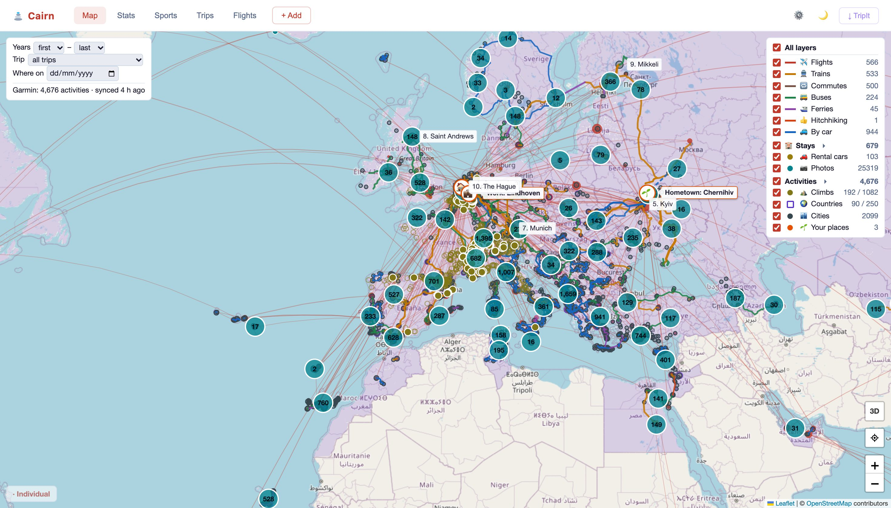
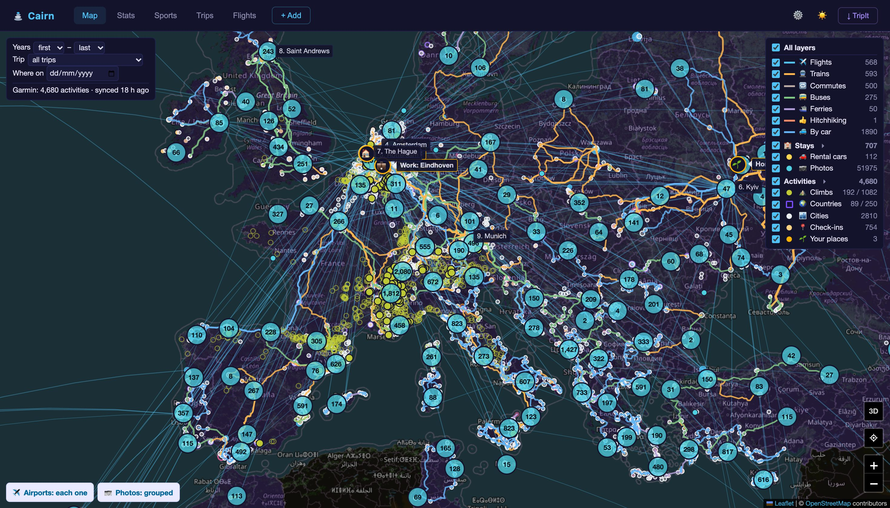

# Contrail

A personal flight tracker that runs on your own machine: a modern replacement for [openflights.org](https://openflights.org/), plus **flightmail**, which reads your booking emails and keeps both Contrail and your travel calendar up to date by itself.

- **Contrail** (`app.js`, `public/`): a small Node/Express web app with a world map of your routes, statistics and a searchable flight list. Flights are stored in `data/flights.json`.
- **flightmail** (`mail/`): a Python job that checks Gmail every hour. It turns flight bookings, schedule changes and cancellations into calendar events and Contrail flights, and train, bus and ferry tickets into calendar events. It uses no LLM and no paid service.





## Contents

- [Features](#features)
- [Repository layout](#repository-layout)
- [Setup](#setup)
- [Running Contrail](#running-contrail)
- [Running on an always-on Mac](#running-on-an-always-on-mac)
- [flightmail](#flightmail)
- [Using Contrail](#using-contrail)
- [Data](#data)
- [API](#api)
- [Tests](#tests)
- [Privacy](#privacy)
- [Troubleshooting](#troubleshooting)

## Features

Contrail:
- **World map** of all your routes with great-circle arcs and airport markers (clustered when zoomed out)
- **Stats dashboard**: total distance, flight hours, airports, countries, airlines, top routes and flights per year
- **Flight list** with search and sortable columns
- **Add a flight by flight number and date**: airports, airline, aircraft and duration are looked up via AeroDataBox
- **Imports** from openflights.org (CSV) and TripIt (calendar link or OAuth)
- **Light and dark mode** (dark by default)

flightmail:
- Reads new Gmail messages every hour, **read only**
- Finds the flights in booking emails from airlines and agencies, in English and Dutch (KLM, Ryanair, easyJet, eDreams, Gotogate, Booking.com, Air France-KLM and similar layouts)
- Creates one **calendar event per flight**, for example `✈️ KL1234: Amsterdam - Lisbon`. Events start and end at the right moment in each airport's time zone, with the booking code (PNR) in the notes.
- Adds the same flight to **Contrail**
- Also adds **trains, buses and ferries** to the calendar, for example `🚆 EC9236: Breda - Bruxelles Midi` or `🚌 Lisboa (Oriente) - Porto (Campanhã)` (not to Contrail, which is a flight log)
- Follows **schedule changes, rebookings and cancellations**
- For every flight: a **check-in to-do in Things**, scheduled the day before, with the airline's check-in link; a **busy block in your work calendar** from 2 hours before departure to 1 hour after landing; and an all-day **trip banner** ("Tenerife", "Portugal") over each trip
- **Never duplicates** a flight that is already in the calendar or in Contrail, and never touches events it did not create
- Posts what it **could not read** to Discord, so a missed booking is not silent

## Repository layout

| Path | What it is |
|---|---|
| `app.js` | Contrail server (Express): REST API, AeroDataBox lookup, imports |
| `public/index.html` | Contrail web page (map, stats, list) |
| `default.config`, `default.secret` | committed templates for `config` and `secret` (see [Setup](#setup)) |
| `test/api.test.js` | tests of the Contrail API |
| `mail/flightmail.py` | flightmail entry point: Gmail, calendar, Contrail and Discord |
| `mail/parse.py` | reads flight legs out of an email (no network) |
| `mail/ground.py` | trains, buses and ferries: operator rules and station time zones (no network) |
| `mail/sync.py` | decides what an email changes; AeroDataBox enrichment (no network) |
| `mail/plan.py` | check-in to-dos, busy blocks and trip banners from the flights you are on (no network) |
| `mail/stays.py` | hotel, Airbnb and rental car bookings out of an email (no network) |
| `mail/tripdocs.py` | trip docs in Google Drive: Google client, the docs' tables, what goes where; `auth` signs in once |
| `mail/test_*.py`, `mail/fixtures/` | flightmail tests and anonymised test emails |
| `mail/install.sh`, `mail/contrail.plist.template` | install flightmail and the Contrail service on a Mac (launchd) |
| `docs/superpowers/` | design and implementation plan of flightmail |

## Setup

Requirements: Node.js 18+ for Contrail; for flightmail also Python 3.10+ on macOS with `pyobjc-framework-EventKit`.

### 1. Install dependencies

In the `contrail` folder:

```
npm install
```

This installs Express, the only dependency.

### 2. Configure

Settings live in `config` and keys in `secret`. Both are JSON files, both are gitignored, and the server does not start without them. Copy the templates:

```
cp default.config config
cp default.secret secret
```

`config`:

| Key | Default | Meaning |
|---|---|---|
| `host` | `127.0.0.1` | address the server listens on: `127.0.0.1` is this machine only, `0.0.0.0` opens it to the network |
| `port` | `3000` | port the server listens on |
| `data_dir` | `data` | folder for runtime data (gitignored) |
| `flights_file` | `data/flights.json` | the flight list |
| `airports_file` | `data/airports.dat` | OpenFlights airport database, downloaded on first run |
| `csv_backup` | `""` | openflights.org CSV export to import on first run (see [Importing](#importing-from-openflightsorg)) |
| `flightmail` | | flightmail settings (see [flightmail settings](#settings)) |

`secret`:

| Key | Meaning |
|---|---|
| `rapidapi_key` | RapidAPI key for AeroDataBox flight lookup (optional, see below) |
| `tripit_client_key`, `tripit_client_secret` | TripIt OAuth app (optional) |
| `flightmail` | flightmail's Gmail app password and Discord webhook (see [flightmail settings](#settings)) |

### 3. AeroDataBox key (optional, recommended)

Flight lookup by number and date uses the [AeroDataBox API](https://rapidapi.com/aedbx-aedbx/api/aerodatabox) via RapidAPI. The free tier allows about 500 lookups per month, which is plenty for personal use.

1. Sign up at [rapidapi.com](https://rapidapi.com)
2. Subscribe to the AeroDataBox API (free tier)
3. Copy your `X-RapidAPI-Key` into `secret` as `rapidapi_key`

Without a key you can still add flights by hand, and flightmail falls back to what the email says.

## Running Contrail

```
node app.js
```

Then open [http://localhost:3000](http://localhost:3000).

On first run the app creates `data/`, downloads `airports.dat` from the [OpenFlights dataset](https://github.com/jpatokal/openflights) (about 6 MB, about 7,700 airports) and, if `csv_backup` is set, imports that CSV into `data/flights.json`. Later starts load `data/flights.json` directly.

## Running on an always-on Mac

Contrail and flightmail can run permanently on another Mac, here a Mac mini reached as `ssh mini`. Contrail listens only on that machine (`"host": "127.0.0.1"`), so nobody else on the network can see or change your flights and no login is needed. That Mac's `data/flights.json` becomes the only copy in use.

1. Make an environment with Node, Python and EventKit, for example with micromamba:
   ```
   micromamba create -n contrail -c conda-forge python=3.12 nodejs=22 pip
   ~/micromamba/envs/contrail/bin/pip install pyobjc-framework-EventKit
   ```
2. Clone the repo, run `npm ci`, and copy `config`, `secret` and `data/` from the machine you used before (`chmod 600 config secret`).
3. Run `mail/install.sh`. It installs the Contrail server as the launchd service `nl.tue.contrail`, which restarts on crash and at login (log: `~/.flightmail/contrail.log`), and it installs flightmail (see [Install](#install)). `PYTHON` and `NODE` override the interpreters it uses.

Open Contrail from your laptop through an ssh tunnel. Use the same port on both ends so the TripIt sign-in callback keeps working:

```
ssh -N -L 3000:localhost:3000 mini
```

then browse to [http://localhost:3000](http://localhost:3000). Stop the tunnel with Ctrl-C.

## flightmail

### What it does

Every hour flightmail reads the Gmail messages that arrived since its last run. For each email:

| Email | What happens |
|---|---|
| **New booking** | One calendar event per flight leg and the same flight in Contrail. Only flights where you are a passenger (`passenger_names`); an email that lists no passengers counts as yours. Only flights that are still ahead. |
| **Schedule change** | The event and the Contrail flight get the new times; the event gets a dated note such as `Updated 2026-10-21: schedule change (Gotogate)`. |
| **Rebooking** | The old flight is deleted from both places and the new one created with a `Rebooked from KL1234 on 2026-11-16` note. |
| **Cancellation** | The event and the Contrail flight are deleted. |
| **Train, bus or ferry ticket** | One calendar event per journey (calendar only). Cancellations delete it, also when the email gives only the booking number. |
| **Hotel, Airbnb or rental car** | Booking.com, Airbnb, DiscoverCars and VIPCars confirmations go into the trip docs (below), not the calendar. Their cancellations undo that. |
| **Anything else** | Ignored: check-in reminders, boarding passes, price alerts, surveys, newsletters, "choose an option" emails, replies and forwards. |

Each event:
- **Title:** `✈️ <flight>: <departure city> - <arrival city>` for flights; `🚆` trains, `🚌` buses and `⛴️` ferries use the station names and, for trains, the train number: `🚆 EC9236: Breda - Bruxelles Midi`
- **Times:** start and end at the real departure and arrival moments; the event's time zone is the departure airport's
- **Location:** the departure airport or station
- **Notes:** `Confirmation Code: <PNR>`, the agency's number if any, and a `flightmail` marker line
- **Alert:** one reminder 15 minutes before
- When an email gives no arrival time (SNCF Connect), the event lasts one hour and its notes say the end time is a guess.

A Contrail flight gets the date, route, flight number, airline and duration; the server computes the distance.

**Around each flight.** flightmail keeps a list of every future flight you are on (and of trains, buses and ferries, for busy blocks), also the ones whose events you made yourself, and on every run keeps three things in step with it. When a flight moves or is cancelled, they follow; things in the past are left alone.
- **Check-in to-do** in a Things project (`things_project`, default "✈️ Travel"), one per booking, for its first flight: `check in KL1234`, scheduled the day before departure (today if that has passed) with its deadline on that same day, with the check-in link (from the booking markup, else the airline's check-in page, else a web search) and the booking code in its notes. A cancelled flight cancels its to-do.
- **Busy block** in your work calendar (`work_calendar_account` / `work_calendar_title`) for each flight, train, bus or ferry that falls in working hours: `🛑 Vibe-busy`, from 2 hours before departure to 1 hour after arrival, made only when that time overlaps Monday to Friday 09:00–17:00 in `home_timezone`. Shown as busy, no alerts, with `[auto-split]` in its notes so [calsplit](https://github.com/bazilinskyy/vibe-work)'s nightly cleanup deletes it once past.
- **Trip banner**: an all-day event in the travel calendar from the day you leave a home airport (`home_airports`) to the day you are back, named after the place you stay ("Tenerife"), the country when you stay in several places ("Portugal"), or the countries ("Spain · France"). It is shown as free, with alerts at 15:00 the day before and 09:00 on the day. When an all-day event of yours already covers the trip, no banner is made. A trip without a known return gets no banner yet.

**Trip docs.** When `trip_docs_folder` is set and flightmail is signed in to Google (see Install), it keeps one Google Doc per trip in that Drive folder. Each doc has an Information heading, a Plan table (Place | Dates | Accommodation | Price | Comments) and a Transport table (Transport | Date | Price | Comments).
- **Which doc:** the doc whose Plan or Transport dates overlap the booking or trip (a day of slack). With none, flightmail creates one with that layout, named after the trip and year: "Faro 2027", the country when it has several places ("Portugal 2026"), with " 2" added if the name is taken.
- **Hotel or Airbnb:** the Plan row with that place and overlapping dates gets the Accommodation (the type, "Hotel", "Hostel", "Flat", "Room" or "House", linked to the booking) and the Price, but only cells that are empty. With no such row, a new row goes in date order with the place, the dates written `22–23.10.26`, the accommodation and the price.
- **Cancelled hotel or Airbnb:** its Accommodation and Price cells are emptied; place and dates stay.
- **Rental car:** `Rental car 26–30.09`, linked to the booking, is added to the Comments (or a Car column) of the row whose stay holds the pick-up day, else to a Transport row.
- **Flights, trains, buses and ferries:** one Transport row each, titled like the calendar event (`✈️ KL1234: Amsterdam - Lisbon`, `🚌 Faro - Albufeira`), with the departure (`07.12.26 16:10`) and the booking code in Comments, in time order: an empty row in that place is filled, else a row is inserted. A cancelled or rebooked trip empties its row. A train, bus or ferry only joins a doc that covers its day; it never creates one, and waits until a flight or stay brings one.
- **Your text is never changed**: flightmail only writes into empty cells, adds rows, and empties the cells it wrote. Bookings that are over are left alone.

**Never twice.** A train, bus or ferry is already in the calendar when any event starts within five minutes of it, whatever its title. A flight that is already in the calendar is not added again. That means an event on the same day whose title holds the same flight number with any airline prefix: `EJU7883`, `U27883` and `U2 7883` are the same flight. In Contrail, a flight on the same day with the same route or the same flight number counts as already there. flightmail never changes or deletes events or flights it did not create.

**Alerts** go to a Discord webhook:
- emails about a trip still ahead that look like a flight booking but could not be read
- changes or cancellations for flights flightmail did not create
- run failures

An alert gives the sender, subject and date, never the email body.

The mailbox is only read (IMAP `EXAMINE`, `BODY.PEEK`): nothing is marked, moved or deleted.

### How it works

1. **Gmail** (`fetch_new`): IMAP with an app password. It reads the All Mail folder, without sent mail, through a broad Gmail search for flight words in several languages. The first run looks back `lookback_days`; later runs read messages newer than the last one seen.
2. **Reading the email** (`parse.py`), in this order:
   - the schema.org `FlightReservation` markup (JSON-LD or microdata) that many airlines embed;
   - labelled blocks (`From:` / `To:` / `Flight number:` / `Departure:` / `Arrival:`, with the old and new sections of a rebooking);
   - otherwise, flight numbers with the airports, dates and times around them.

   A flight number counts only when its airline exists in OpenFlights' `airlines.dat` and an airport or a flight word is nearby, so codes like `V33IPW` or an IBAN are not mistaken for flights. Dates and times are read in English and Dutch. Booking codes come from labels such as PNR, booking reference, boekingscode or reserveringsnummer, and agency numbers from eDreams, Booking.com and Gotogate. The email is classed as booking, change, cancellation or other.
3. **AeroDataBox** (`sync.enrich`): for every future leg, flightmail asks Contrail's `/api/flights/lookup` for the airports and scheduled local times of that flight number on that day, and these win over the email. This fixes layouts that give only city names or put details in odd places. Each flight and day is looked up once (cache `~/.flightmail/lookups.json`), at most `lookup_monthly_limit` times per month. Flights AeroDataBox does not know keep the email's data.
4. **Deciding** (`sync.apply`): the rules above, against a state file that remembers which events and Contrail flights flightmail created.
5. **Trains, buses and ferries** (`ground.py`): recognised by the sender (NS International, SNCF Connect, Deutsche Bahn, Eurostar, Trainline, FlixBus, redBus, Rede Expressos, 12Go, ferry operators and more) or by schema.org `BusReservation` / `TrainReservation` / `BoatReservation` markup, which is read first. NS International, SNCF Connect, redBus and Rede Expressos have their own text rules. A station's time zone comes from the [GeoNames](https://www.geonames.org/) list of towns over 1,000 people (`data/cities1000.txt`, downloaded once, CC BY 4.0): the biggest town whose name starts the station name ("Bruxelles Midi" → Brussels), else `home_timezone`.
6. **Writing:** calendar events go through macOS Calendar (EventKit), so any calendar macOS sees works, for example a Google calendar added in System Settings. Contrail flights go through its REST API.

Time zones come from the airport database: every local time is placed in its airport's zone, including across daylight-saving changes and for flights that land after midnight.

### Settings

In the `"flightmail"` sections of `config` and `secret`:

| Key | File | Meaning |
|---|---|---|
| `gmail_user` | config | the Gmail address to read |
| `passenger_names` | config | your name(s) as on tickets, e.g. `["Jan Testers"]` |
| `calendar_account`, `calendar_title` | config | the calendar to write to, as macOS Calendar names them (default `Google` / `Travel`); `mail/flightmail.py calendars` lists them |
| `lookback_days` | config | how far the first run looks back (default 365) |
| `contrail_url` | config | Contrail's address (default `http://127.0.0.1:3000`) |
| `lookup_monthly_limit` | config | maximum AeroDataBox lookups per month (default 100) |
| `home_timezone` | config | time zone for stations that match no known town (default `Europe/Amsterdam`) |
| `things_project` | config | Things project for check-in to-dos (default `✈️ Travel`) |
| `work_calendar_account`, `work_calendar_title` | config | calendar for busy blocks (default `TUe` / `Calendar`) |
| `home_airports` | config | airports a trip starts from and returns to (default `AMS`, `EIN`, `RTM`) |
| `trip_docs_skip` | config | booking codes that never go into a trip doc (for example a work trip) |
| `trip_docs_folder` | config | id of the Google Drive folder for trip docs (the part after `folders/` in its link); empty: no trip docs |
| `gmail_query` | config | optional Gmail search that preselects mail; empty uses the built-in one |
| `gmail_app_password` | secret | a Gmail [app password](https://myaccount.google.com/apppasswords) (needs 2-Step Verification) |
| `discord_webhook` | secret | Discord webhook for alerts; empty sends nothing |

### Install

On the always-on Mac, from the checkout:

```
mail/install.sh
```

macOS gives calendar access per app and silently refuses it to a bare Python started by launchd. So the script builds a small AppleScript app, `~/.flightmail/flightmail.app`, which holds the Calendar permission and runs `flightmail.py`. It builds the app only once, because a rebuild changes its signature and macOS would ask again. The script then schedules the app every 60 minutes (launchd `nl.tue.flightmail`) and installs the Contrail service if it is missing.

Then fill in the `flightmail` settings and, **with the screen unlocked**, run a dry run and click Allow on the Calendar prompt (and, on the first real run that makes a to-do, on the prompt to control Things):

```
open -W --env FLIGHTMAIL_ARGS=--dry-run ~/.flightmail/flightmail.app; tail -40 ~/.flightmail/run.log
```

A dry run reads the mail and logs what it would create, update or delete, without changing anything. Only lookups happen, and they are cached. Read the list, then run once for real:

```
open -W ~/.flightmail/flightmail.app; tail -40 ~/.flightmail/run.log
```

The first run reads a year of matching mail and takes about ten minutes; later runs take seconds.

**Trip docs (optional).** flightmail edits Google Docs with its own Google sign-in, made once:
1. In the [Google Cloud console](https://console.cloud.google.com/), create a project (any name), then enable the **Google Drive API** and the **Google Docs API** (APIs & Services → Library).
2. APIs & Services → OAuth consent screen: user type **External**, fill in the app name and your email, add yourself as a test user, then **Publish app** (status "In production"). In testing status Google expires the sign-in after 7 days. The app stays unverified; that only means a warning when you sign in.
3. APIs & Services → Credentials → Create credentials → **OAuth client ID**, type **Desktop app**. Download the JSON and copy it to the Mac as `~/.flightmail/google_client.json`.
4. Sign in once. On the Mac itself: `python mail/tripdocs.py auth` and open the printed link. From another computer, keep a tunnel open so Google's redirect reaches the Mac: `ssh -L 8765:localhost:8765 <mac>`, run the command there, and open the link on your own computer. After you allow access (click past the "unverified app" warning), the refresh token is saved to `~/.flightmail/google_token.json` (mode 600).
5. Set `trip_docs_folder` in `config`, then do a dry run: it lists every cell it would write and every doc it would create.

The sign-in asks for full Drive access, because the trip docs you made yourself must be editable too.

### Files

| File | What it is |
|---|---|
| `~/.flightmail/run.log` | log: each email acted on, each change, alerts and failures |
| `~/.flightmail/state.json` | last message read, and the events and Contrail flights flightmail created |
| `~/.flightmail/lookups.json` | AeroDataBox answers and this month's lookup count |
| `~/.flightmail/flightmail.app` | the app that holds the Calendar permission |
| `~/.flightmail/google_client.json`, `google_token.json` | the Google OAuth client and refresh token for the trip docs; never in the repo |

Other commands: `mail/flightmail.py calendars` lists the calendars EventKit sees. `--rescan-days N` reads all matching mail of the last N days again, for example after new rules were added (`open -W --env FLIGHTMAIL_ARGS="--rescan-days 365" ~/.flightmail/flightmail.app`); nothing is added twice.

To remove the hourly job:

```
launchctl bootout gui/$(id -u)/nl.tue.flightmail; rm ~/Library/LaunchAgents/nl.tue.flightmail.plist
```

### Limits

- **Languages:** English and Dutch text rules. Other languages (for example French Transavia emails) are read only through schema.org markup or AeroDataBox.
- **Attachments:** PDF e-tickets and attachments are not read.
- **Not read:** trains, buses and ferries from operators without a rule or markup; add a rule in `ground.py` with a fixture and a test. Hotels and cars other than Booking.com, Airbnb, DiscoverCars and VIPCars; add a rule in `stays.py`.
- **Trip docs:** a cancelled rental car is only logged; remove it from the doc by hand. A changed booking is treated as cancelled and booked again.
- **New layouts:** a layout none of the rules handle shows up as a "could not read" alert. To support it, add an anonymised copy to `mail/fixtures/`, a test in `mail/test_parse.py`, then a rule in `parse.py`.

## Using Contrail

### Adding a flight

1. Click **+ Add Flight** in the navigation bar
2. Enter the flight number (e.g. `KL1234`) and the departure date
3. Click **Look Up Flight**: AeroDataBox fills in airports, airline, aircraft, distance and duration
4. Check the fields and click **Save Flight**

If the flight is not found (common for old flights), click **Fill Manually**. The minimum is **From**, **To** and **Date**.

### Importing from openflights.org

Export your flights from openflights.org as CSV and put the file in the repo folder. Set `csv_backup` in `config` to its file name, delete `data/flights.json` if it exists, and restart the server: the CSV is imported. The standard openflights.org format is understood:

```
Date,From,To,Flight_Number,Airline,Distance,Duration,Seat,Seat_Type,Class,Reason,Plane,Registration,Trip,Note,From_OID,To_OID,Airline_OID,Plane_OID
```

Missing distances are computed from airport coordinates (Haversine formula).

### Importing from TripIt

Click **↓ TripIt** in the navigation bar.

- **Calendar link (no credentials):** on tripit.com go to Profile → Account → Email & Calendar, copy the link under *Subscribe to your travel schedule*, paste it into the dialog and click **Import**.
- **OAuth (more complete: cabin class, seat, aircraft):**
  1. Register a developer app at [tripit.com/developer](https://www.tripit.com/developer).
  2. Put its key and secret in `secret` as `tripit_client_key` / `tripit_client_secret`.
  3. Restart the server and click **Authorise with TripIt**.

Existing flights (same date, route and flight number) are never imported twice.

## Data

All flights are in `data/flights.json`, a JSON array; `data/` is gitignored. To back up, copy that file.

| Field | Description |
|-------|-------------|
| `id` | number, assigned by the server |
| `date` | departure date/time (`YYYY-MM-DD` or `YYYY-MM-DD HH:MM:SS`, local time) |
| `from`, `to` | departure and arrival airport IATA codes |
| `flight_number` | e.g. `KL1234` |
| `airline` | airline name |
| `distance` | great-circle distance in km |
| `duration` | flight time `HH:MM` |
| `plane` | aircraft type (e.g. `Boeing 737 MAX 8`) |
| `seat`, `seat_type` | seat number; window/aisle/middle |
| `class` | cabin class (`Y` economy, `C` business, `F` first) |
| `reason` | trip reason (`B` business, `L` leisure) |
| `registration` | aircraft registration |
| `trip`, `note` | trip name or ID; free text |

Moving to MongoDB later only needs the data layer in `app.js` (the `flights` array, `saveFlights()` and `init()`) replaced by a Mongoose model; the API routes stay the same.

## API

| Method | Path | Description |
|--------|------|-------------|
| `GET` | `/api/flights` | all flights as a JSON array |
| `GET` | `/api/airports` | airport metadata for the airports in your flights |
| `POST` | `/api/flights/lookup` | look up a flight by number and date via AeroDataBox: `{ "flight_number": "KL1234", "date": "2026-11-16" }` → airports, airline, aircraft, distance, duration, local departure and arrival times |
| `POST` | `/api/flights` | add a flight (at least `from`, `to` and `date`); the distance is computed when missing |
| `PUT` | `/api/flights/:id` | change fields of a flight; the distance is recomputed when the route changes |
| `DELETE` | `/api/flights/:id` | delete a flight |

## Tests

```
npm test                       # Contrail API, against a temporary copy with its own data
python mail/test_parse.py      # reading emails (the fixtures in mail/fixtures)
python mail/test_ground.py     # trains, buses and ferries, station time zones
python mail/test_sync.py       # the change, rebooking, cancellation and duplicate rules
python mail/test_plan.py       # check-in to-dos, busy blocks, trip banners
python mail/test_stays.py      # hotel, Airbnb and rental car emails
python mail/test_tripdocs.py   # trip docs, against a fake Google Docs
python mail/test_flightmail.py # entry point, Contrail client, alerts
```

The Python tests need no network, Gmail or calendar, and no pytest: each file runs on its own and prints `OK n tests`.

## Privacy

This repository is public, so nothing personal is committed:
- `config`, `secret` and `data/` are gitignored, along with flightmail's files in `~/.flightmail/`.
- The test emails in `mail/fixtures/` are anonymised copies of real layouts. Names, booking codes, agency numbers, flight numbers, routes, dates, prices and links are replaced with fake ones (`Jan Testers`, `ABC123`, `example.com`).
- flightmail reads the mailbox read only and keeps no copy of any email.

## Troubleshooting

**airports.dat download fails on first run.** Download it by hand:
```
curl -o data/airports.dat https://raw.githubusercontent.com/jpatokal/openflights/master/data/airports.dat
```
Without it the map still renders, but without route arcs and airport markers.

**"No RapidAPI key in secret file".** `secret` is missing or has an empty `rapidapi_key` (see [AeroDataBox key](#3-aerodatabox-key-optional-recommended)).

**Port already in use.** Change `port` in `config` and restart.

**CSV import does not find the backup.** `csv_backup` must match the exact file name, which must be in the repo folder.

**flightmail: "Empty username or password" or "AUTHENTICATIONFAILED".** Set `gmail_user` in `config` and a valid `gmail_app_password` in `secret`. A normal Google password does not work over IMAP.

**flightmail: "No calendar access".** Run the dry run once with the screen unlocked and click Allow. Otherwise allow flightmail in System Settings → Privacy & Security → Calendars. Never rebuild `flightmail.app`: a new signature needs a new Allow.

**flightmail: "Expected one calendar".** `calendar_account` and `calendar_title` must match macOS Calendar exactly; `mail/flightmail.py calendars` lists them.

**flightmail missed a booking.** Look for a "could not read" alert or the email's line in `run.log`. If the email has no flight words at all, widen `gmail_query`.
